# Instalación paso a paso

**Para quién es:** para la persona de la institución que va a poner en marcha el sistema. No hace falta saber de tecnología: hay que seguir los pasos **en orden**, sin saltear ninguno.

**Qué hace falta:**

- Una **computadora** con internet y el navegador **Chrome**.
- Un **celular** (para la verificación en dos pasos y la app **Google Authenticator**).
- Entre **1 hora y 1 hora y media**, sin apuro. **Se puede hacer en partes**: al terminar cada paso, se puede frenar y seguir otro día.
- La **Hoja de accesos** (documento 1) **impresa** y una lapicera. Las contraseñas y claves se anotan **solo ahí, a mano**: nunca en la computadora, en el correo ni en WhatsApp.

**Cómo es:**

1. **A mano (pasos 1 a 6):** crear las cuentas que los servicios exigen que cree una persona y copiar cuatro claves.
2. **Automático (paso 7):** tocar el botón **Instalar**. El sistema hace todo lo demás.
3. **Desde la aplicación (paso 8):** seguir la lista **Primeros pasos** del panel.

> **Regla de oro:** cada servicio lleva **una contraseña distinta**. Todas van a la Hoja de accesos.

> 📝 En cada paso, el recuadro **«Anotá en la hoja»** dice qué casillas completar (por ejemplo, **B2**). El recuadro **«✅ Cómo sé que salió bien»** dice qué tiene que aparecer antes de seguir.

---

## Paso 1. El Gmail de la institución

Todas las cuentas quedan a nombre de este correo, no de una persona. Si mañana otra persona se hace cargo, se le entrega este acceso.

**Crear la cuenta** (se hace en la computadora, con Chrome):

1. En Chrome, escribí en la barra de arriba **accounts.google.com/signup** y apretá **Enter**. Si ya tenés tu Gmail personal abierto en ese Chrome, mejor abrí una **ventana de incógnito** (Ctrl + Shift + N) y hacelo ahí: así no se mezclan las cuentas.
2. **«Crea una cuenta de Google»**: en **Nombre** escribí algo que identifique al sistema, por ejemplo «Inscripciones», y en **Apellidos** el nombre de la institución, por ejemplo «Club Las Palmas». Tocá **Siguiente**.

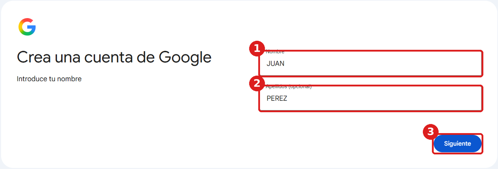

3. **«Información básica»**: la fecha de nacimiento y el género **del Responsable general** (tiene que ser mayor de edad). Tocá **Siguiente**.

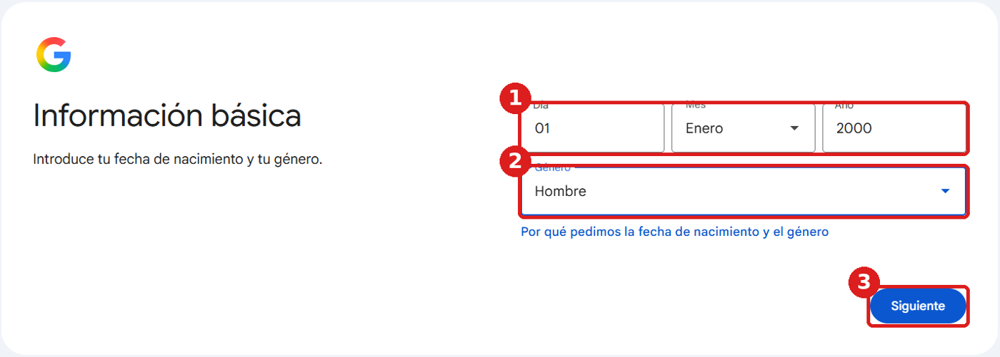

4. **«Cómo iniciarás sesión»** (la dirección de Gmail): escribí la dirección, por ejemplo **inscripciones.laspalmas** (Google agrega «@gmail.com» solo). Si dice que ya existe, agregale algo (la ciudad, un número). A veces Google muestra dos o tres direcciones sugeridas y la opción **«Crea tu propia dirección de Gmail»**: elegí esa. **No** toques «Usar tu correo electrónico». Tocá **Siguiente**. 📝 **Anotalo ya en la hoja, casilla B1** (la dirección completa, con @gmail.com).

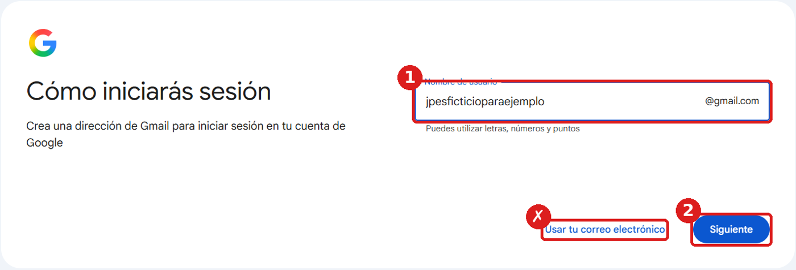

5. **«Crea una contraseña segura»**: una contraseña larga, nueva, que no uses en otro lado. Escribila dos veces (**Contraseña** y **Confirmar**). 📝 **Anotala ya en la hoja, casilla B2, antes de tocar Siguiente.** Tocá **Siguiente**.

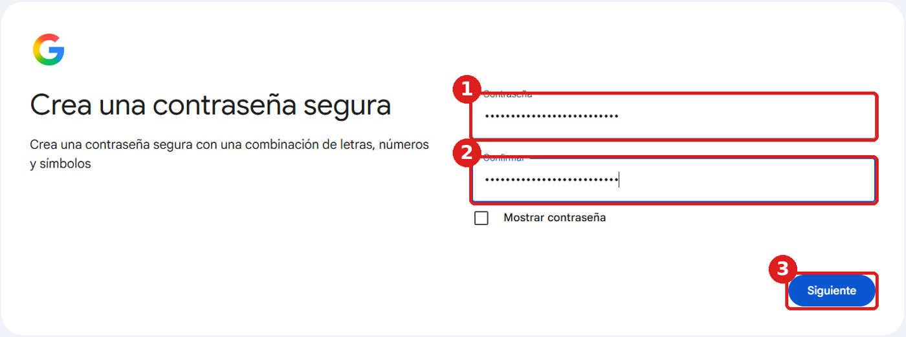

6. **«Verifica algunos datos antes de crear una cuenta»**: Google muestra un **código QR** (un cuadrado de puntitos). En el celular del Responsable general, abrí la **cámara**, apuntá al QR y tocá el enlace que aparece. Seguí los pasos en el celular (puede pedir mandar un SMS) y **volvé a la computadora**. Usá los **datos móviles** del celular, no el Wi-Fi, y no reintentes muchas veces seguidas (después de varios intentos, Google frena unas horas). Otras veces, en lugar del QR, pide directamente el número de celular y manda un código por SMS. 📝 **Anotá el celular en la hoja, casilla B3.**

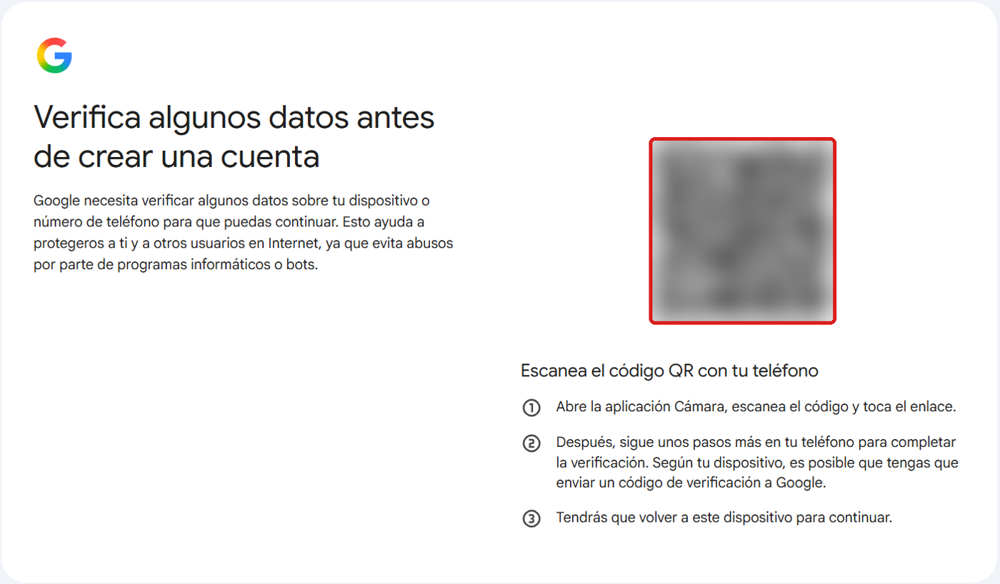

   En el celular puede aparecer, en inglés, **«Are you trying to verify your info?»** (¿estás intentando verificar tus datos?), con el tipo de computadora y la ciudad. Si coinciden con los tuyos, tocá **Yes, continue** (sí, continuar).

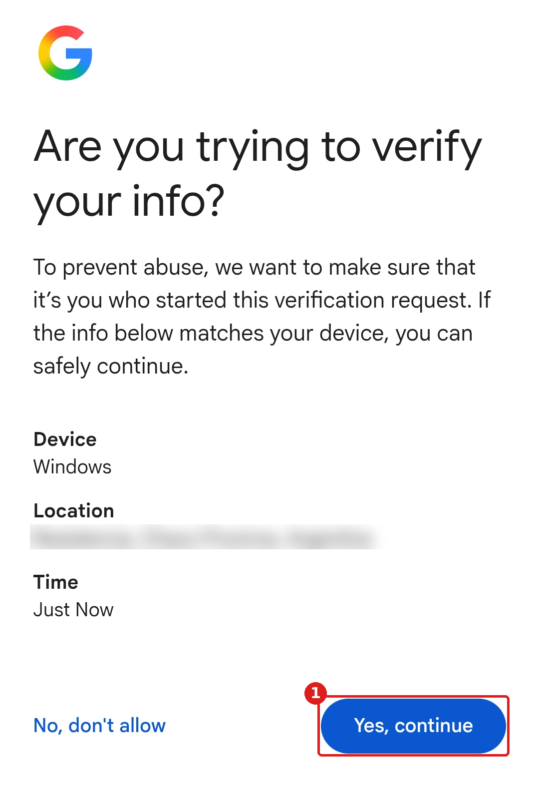

7. **«Añadir correo de recuperación»**: poné el correo personal del Responsable general y tocá **Siguiente** (no «Saltar»): sirve para recuperar la cuenta si se olvida la contraseña. 📝 **Anotalo ya en la hoja, casilla B4.**

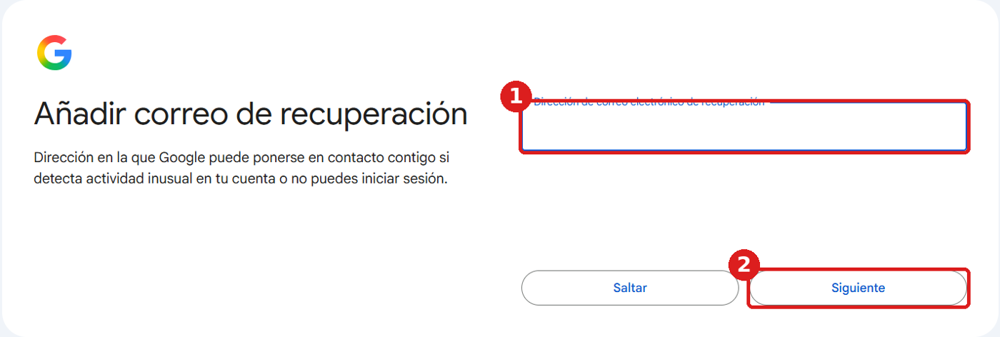

   Después aparecen, en este orden (pueden variar un poco):
   - **«Add a recovery contact»** (agregar un contacto de recuperación, una persona de confianza): tocar **Saltar**.
   - **«Revisa la información de tu cuenta»**: muestra el nombre y la dirección nueva. Tocar **Siguiente**.
   - **«Privacidad y Términos»**: un texto largo. Bajar hasta el final y tocar **Acepto** (abajo a la derecha).
   - Si ofrece **agregar el número a otros servicios** o **personalizar la configuración**, elegir lo más simple («Saltar», «Ahora no» o la opción **Express**).
   Al final aparece la página **«Google Cuenta»** con el nombre y la dirección nueva (a veces, en cambio, la bandeja de Gmail): **la cuenta está creada**. Si aparece el cartel amarillo «Añade un teléfono de recuperación», tocá **Añadir teléfono de recuperación** y cargá el celular del Responsable general (es el mismo de la casilla B3). Si se abre sola una lista de aplicaciones a la derecha («Tus favoritos»), cerrala tocando en cualquier otro lugar.

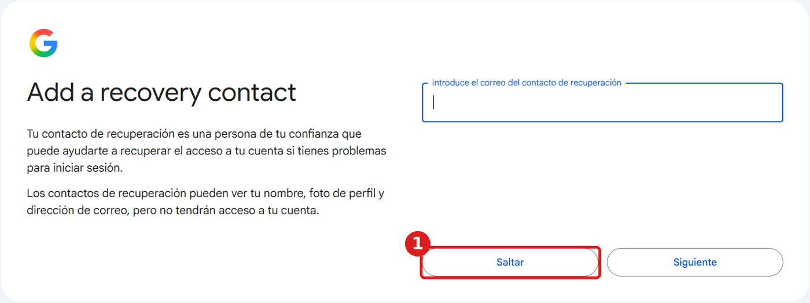

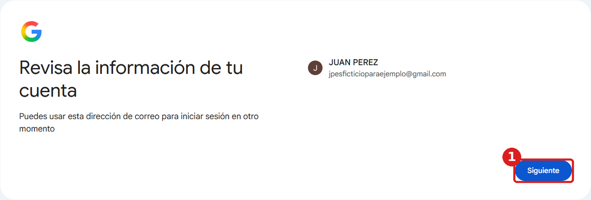

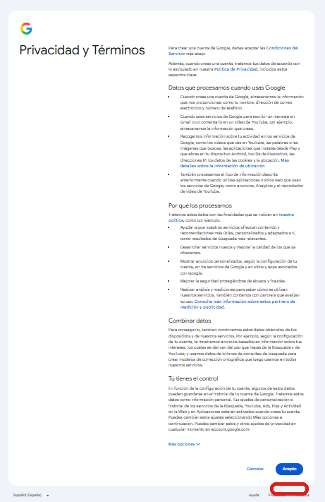

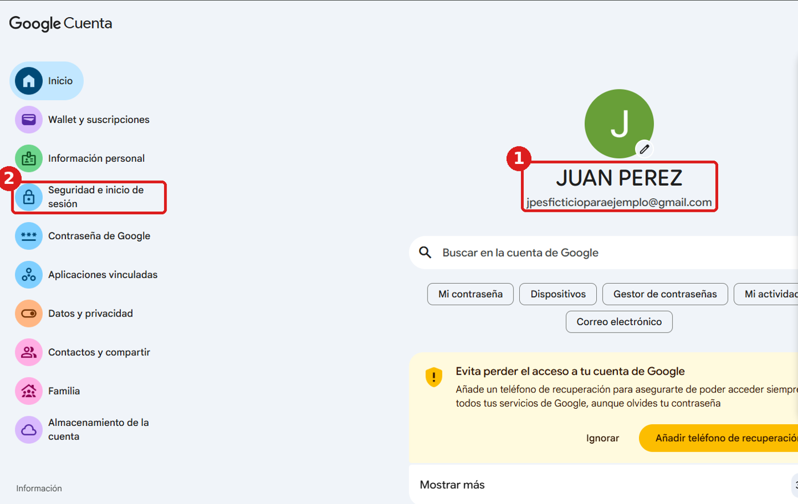

8. **Correo de recuperación** (si no lo pidió en el punto 7): agregar el correo personal del Responsable general (**myaccount.google.com → Seguridad → Correo de recuperación**). Evita quedar bloqueado. 📝 **Anotalo ya en la hoja, casilla B4.**

**Verificación en dos pasos (obligatoria):** protege la cuenta: aunque alguien sepa la contraseña, no puede entrar sin el celular.

1. Entrá a **myaccount.google.com/security** (o, en la página «Google Cuenta», tocá **Seguridad e inicio de sesión** a la izquierda). Bajá hasta **«Cómo inicias sesión en Google»** y tocá **Verificación en dos pasos**.

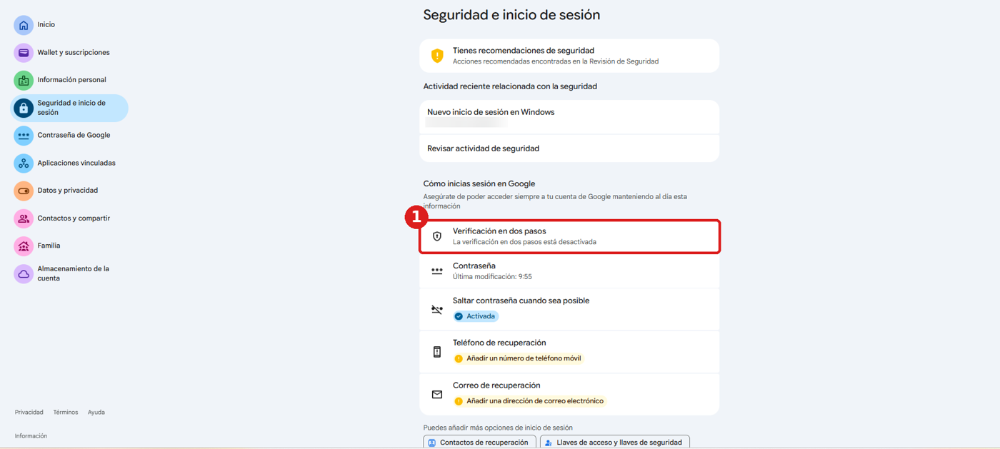

2. **Primero hay que agregar el celular.** Tocá **Número de teléfono**. (Si tocás antes el botón azul «Activar verificación en dos pasos», aparece el cartel «Añade segundos pasos a tu cuenta»: tocá **Atrás** y hacé este punto.)

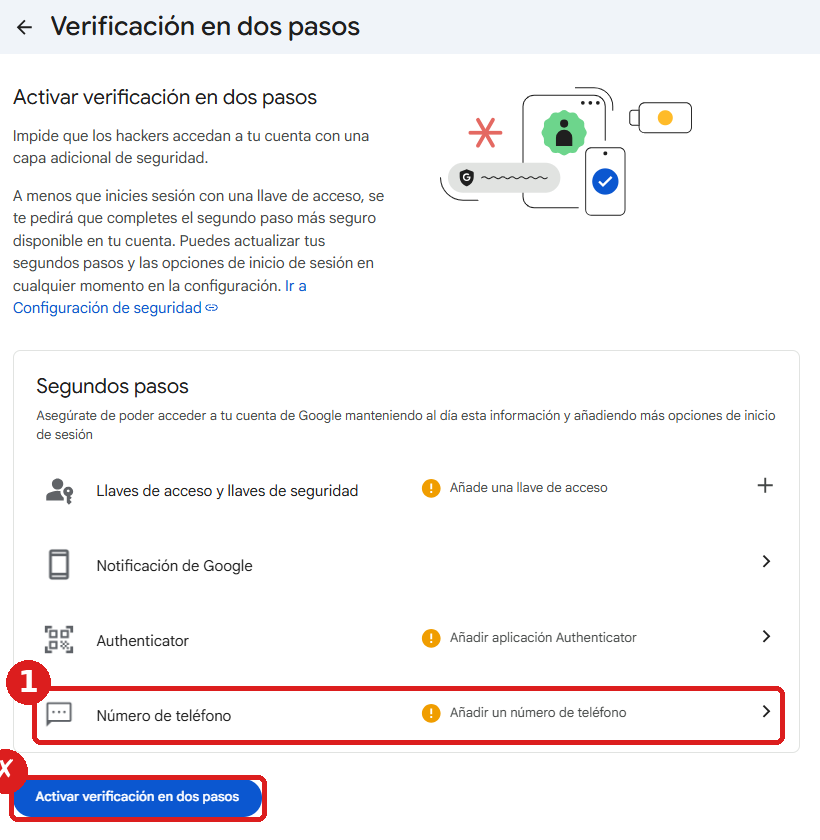

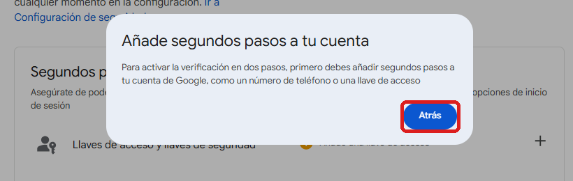

3. Tocá **Añadir número de teléfono**. Escribí el celular del Responsable general **después del +54**: la característica **sin el 0** y el número **sin el 15** (por ejemplo, **362 4555666**). Google también lo acepta con un 9 adelante (9 362 4555666): las dos formas sirven. Si el SMS no llega, probá de la otra forma. Dejá marcado **Recibir códigos por mensaje de texto** y tocá **Siguiente**. Llega un SMS con un código: escribilo y tocá **Verificar**. 📝 **Anotá el celular en la hoja, casilla B3.**

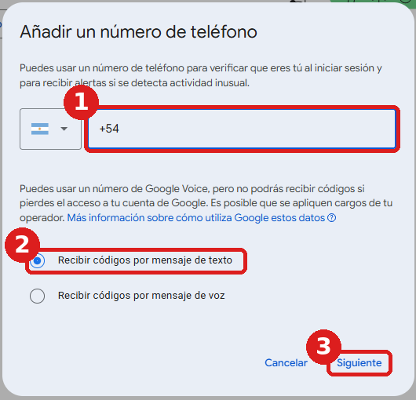

4. Aparece **«Ahora tu cuenta está protegida por la verificación en dos pasos»**: se activó sola. Tocá **Listo**.
5. En la misma página, abajo, tocá **Códigos de verificación alternativos** → **Obtener códigos**. Aparecen **10 códigos de 8 números**. 📝 **Anotalos ya en la hoja, casilla B5.** Cada uno sirve una sola vez para entrar si no tenés el celular.

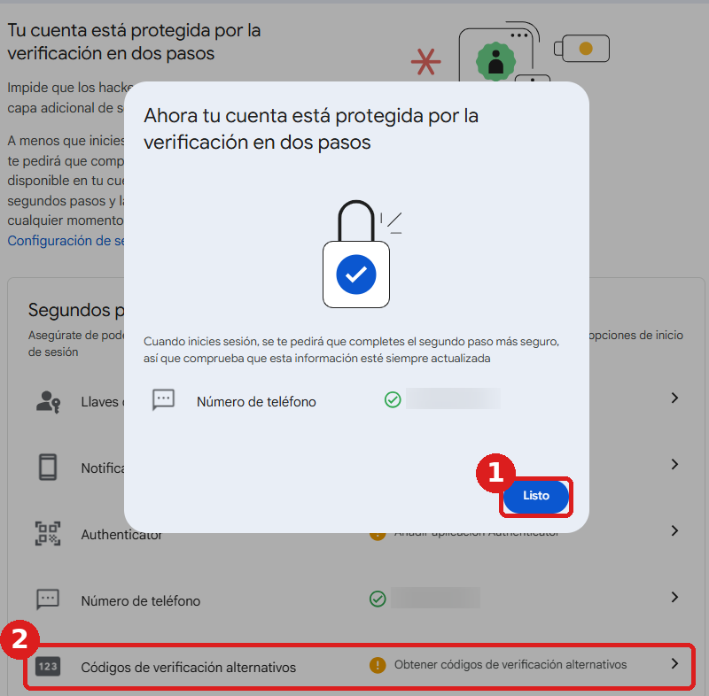

   **Si al entrar ya aparece una lista** con **Número de teléfono** con un ✅ verde y abajo el botón **«Desactivar la verificación en dos pasos»**: **ya está activada** (pasa cuando el celular ya estaba cargado). Seguí directo con el punto 5.

> **Si el SMS no llega:** revisá el número: después del +54 va la característica sin 0 y el número sin 15 (por ejemplo, +54 362 4555666; con un 9 adelante también sirve). Elegí **«Llamada de voz»** para que Google te dicte el código. Esperá 2 o 3 minutos antes de pedir otro. Si sigue sin llegar, usá otro número o probá unas horas más tarde (Google limita los códigos a un número que ya está en varias cuentas).

> Si Google pide «escaneá este QR con tu celular»: usar los **datos móviles** del celular (no el Wi-Fi) y no reintentar muchas veces seguidas; después de varios intentos, Google bloquea el acceso por unas horas.

**Contraseña de aplicación** (para que el sistema pueda mandar los códigos de ingreso por correo):

1. En la **misma ventana de Chrome** donde está abierta la cuenta de Google de la institución, hacé clic en la **barra de direcciones** (la de arriba de todo, donde se escriben las páginas), borrá lo que haya, escribí **myaccount.google.com/apppasswords** y apretá **Enter**. Si pide la contraseña, escribila (B2). Se abre la página **«Contraseñas de aplicaciones»**. (No hay botón para llegar tocando: hay que escribir la dirección.)
2. **Google puede pedir «Demuestra que eres tú»** (demostrá que sos vos), porque es una página delicada:
   - Si pide **confirmar el número de teléfono**: primero tocá la **banderita** de la izquierda y elegí **Argentina** (a veces viene la de Estados Unidos). Escribí el celular (B3), sin 0 y sin 15, y tocá **Enviar**.
   - Llega un SMS con un código: escribilo (después de la «G-») y tocá **Siguiente**.

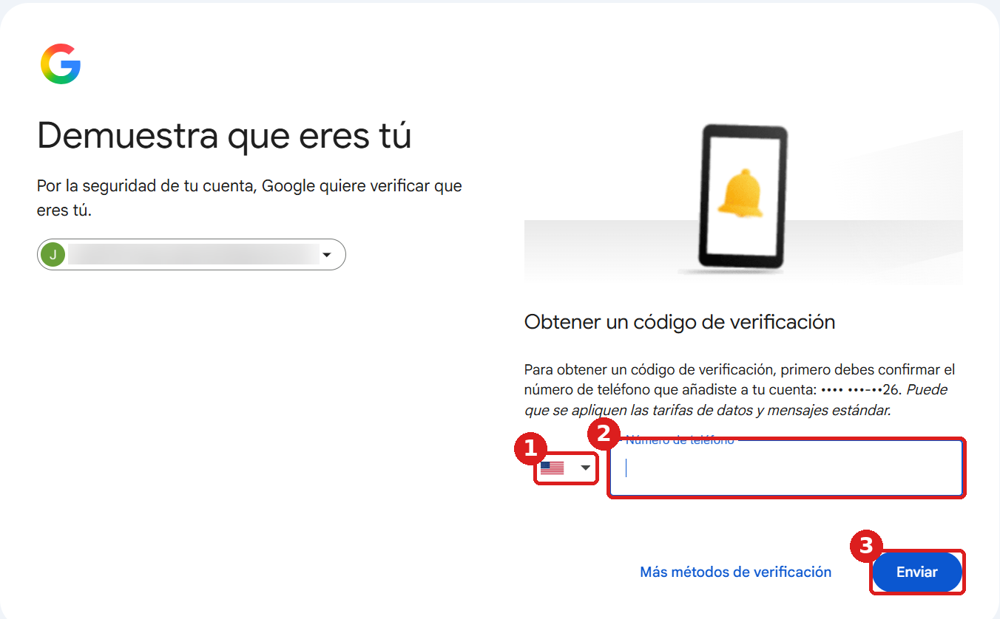

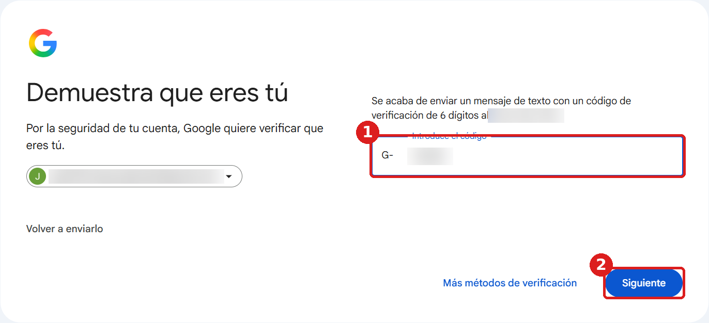

3. En **«Contraseñas de aplicación»**, donde dice **Nombre de la aplicación**, escribí **Supabase** y tocá **Crear**.

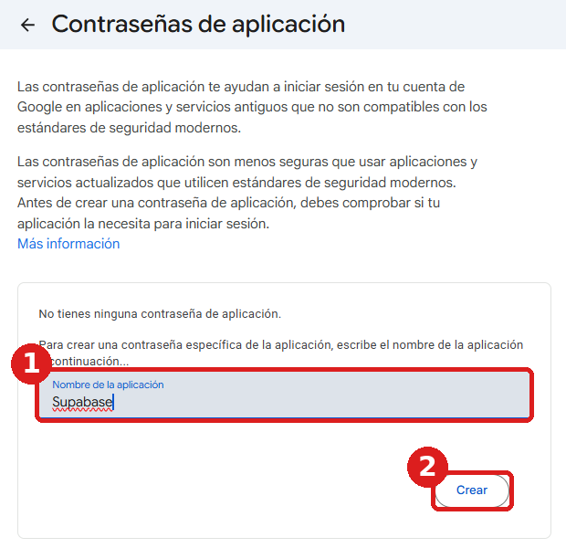

4. Aparece **«Contraseña de aplicación generada»**: una clave de **16 letras** en cuatro grupos (por ejemplo «abcd efgh ijkl mnop»). 📝 **Anotala ya en la hoja, casilla B6, antes de tocar Hecho: Google la muestra una sola vez.** (El cartel dice «no la escribas»: en este sistema sí hace falta, porque se pega en GitHub en el paso 6; por eso va solo a la hoja de papel.) Después tocá **Hecho**.

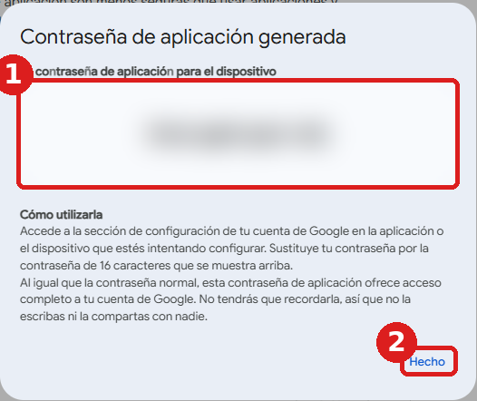

> Si la página dice que no está disponible, la verificación en dos pasos todavía no quedó activa: esperar unos minutos y volver a probar.

> 📝 **Anotá en la hoja:** B1 (dirección), B2 (contraseña), B3 (celular), B4 (correo de recuperación), B5 (códigos de seguridad) y B6 (contraseña de aplicación de 16 letras).

> ✅ **Cómo sé que salió bien:** abrí una **ventana de incógnito** (Ctrl + Shift + N), entrá a **gmail.com** con la dirección y la contraseña: tiene que pedir **un segundo paso** (un código o una confirmación en el celular).

## Paso 2. La cuenta de GitHub

GitHub guarda el programa de la aplicación y hace las tareas automáticas (instalar, publicar, respaldos, revisión diaria).

> 🌐 **GitHub, Supabase y Cloudflare están en inglés.** No hace falta saber inglés: en este manual, cada botón aparece **en negrita, tal cual se ve en la pantalla**, y al lado, entre paréntesis, qué quiere decir. **No uses el traductor de Chrome** en estas páginas: cambia los nombres de los botones y ya no coinciden con el manual.

> 📝 **Cada vez que aparezca una contraseña, un código o una dirección para guardar, el manual dice «Anotalo ya en la hoja» con la casilla.** Hacelo en ese momento: muchas pantallas no vuelven a mostrar el dato. El recuadro amarillo del final de cada paso sirve para revisar que no falte nada.

> ✋ **Regla general: si aparece un casillero, una opción o una pregunta que el manual no nombra, dejalo como está** (vacío o con lo que ya trae) y seguí. Solo hay que tocar lo que el manual dice.

> 🤖 **«¿Sos un robot?»** Al registrarte o entrar, GitHub (y también Google o Cloudflare) a veces muestra un control para comprobar que sos una persona: **deslizar una flecha hacia la derecha** (en inglés dice «Verification Required» y «Slide right to secure your access»: es lo mismo), elegir imágenes o resolver un pequeño juego. Es normal y no tiene nada que ver con la aplicación: hacé lo que pide, despacio. Si sale mal, aparece otro; probá de nuevo. Con el botón del parlante 🔊 se puede hacer escuchando.

1. Entrar a **github.com/signup** (página para crear una cuenta).
2. Completar, uno por uno, lo que pide la pantalla:
   - **Email** (correo): el Gmail de la institución.
   - **Password** (contraseña): una **contraseña nueva**, distinta de la del Gmail. 📝 **Anotalo ya en la hoja, casilla C2.** GitHub pide **15 caracteres o más** (o al menos 8 con algún número y alguna minúscula).
   - **Username** (nombre de usuario): por ejemplo **inscripciones-laspalmas** (letras, números y guiones; sin espacios). Si dice que ya existe, agregale algo (por ejemplo, la ciudad). 📝 **Anotalo ya en la hoja, casilla C1.**
   - **Your Country/Region** (país): Argentina.
   - **No** usar los botones «Continue with Google» ni «Continue with Apple»: completar los casilleros. La casilla **Email preferences** (recibir novedades) se deja sin tildar.
   - Tocar **Create account** (crear cuenta).

3. Aparece el control **«¿sos un robot?»** (ver arriba). Resolverlo.
4. GitHub manda un **código de 8 números al Gmail**: abrir el Gmail, copiarlo y escribirlo en GitHub.
5. Si pregunta por un plan, elegir **Free** (gratis). Si hace preguntas sobre para qué lo vas a usar, se pueden saltear con **Skip** (saltear) o **Continue** (continuar).
6. **Verificación en dos pasos** (obligatoria): tocar la **foto de perfil** (el círculo de arriba a la derecha) → **Settings** (configuración) → en el menú de la izquierda, **Password and authentication** (contraseña y autenticación) → **bajar con la ruedita del mouse** hasta el título **Two-factor authentication** (verificación en dos pasos) → botón verde **Enable two-factor authentication** (activar).

 A veces GitHub ya la pide sola al registrarte: es lo mismo.

7. Elegir **Authenticator app** (aplicación de autenticación). En el celular, instalar **Google Authenticator** (desde Play Store o App Store), abrirla, tocar **+** → **Escanear un código QR** y apuntar a la pantalla de la computadora. En el celular aparece un número de **6 dígitos** que cambia cada 30 segundos: escribirlo en GitHub y tocar **Continue**. 📝 **Anotalo ya en la hoja, casilla C3.** (en qué celular quedó Google Authenticator)
8. GitHub muestra los **recovery codes** (códigos de recuperación, sirven si perdés el celular). Tocar **Download** (descargar) e imprimirlos, o copiarlos a mano. 📝 **Anotalo ya en la hoja, casilla C4.** (dónde quedaron guardados) Después tocar **I have saved my recovery codes** (ya guardé mis códigos) y **Done** (listo).

> 📝 **Anotá en la hoja:** C1 (usuario), C2 (contraseña), C3 (en qué celular está Google Authenticator) y C4 (dónde guardaste los recovery codes).

> ✅ **Cómo sé que salió bien:** tocá la foto de perfil → **Sign out** (cerrar sesión) y volvé a entrar en **github.com/login**: tiene que pedir la contraseña **y** el número de 6 dígitos de Google Authenticator.

## Paso 3. La copia de la aplicación

1. Con la sesión de GitHub de la institución abierta, entrar a la **plantilla**: **github.com/inscripciones-iglesia/app-inscripciones-plantilla**. (Es el molde que copian **todas** las instituciones, sean o no iglesias: no tiene datos de nadie, y la copia que hacés queda en tu cuenta, privada.)
2. Tocar el botón verde **Use this template** (usar esta plantilla) → **Create a new repository** (crear un repositorio nuevo; «repositorio» es la carpeta donde GitHub guarda la aplicación).

3. Completar:
   - **Owner** (dueño): la cuenta de la institución (ya aparece elegida).
   - **Repository name** (nombre): **app-inscripciones**.
   - **Description** (descripción): dejarlo **vacío**.
   - **Include all branches** (incluir todas las ramas), si aparece: **no tildarlo**.
   - **Choose visibility** (quién lo puede ver): **viene en «Public»; hay que cambiarlo**: tocar «Public» y elegir **Private** (privado: solo lo ve la institución).
   - Tocar **Create repository** (crear repositorio) y esperar unos segundos. Aparece la página de tu copia: la dirección de arriba del navegador (github.com/…/app-inscripciones) 📝 **Anotalo ya en la hoja, casilla C5.**

> 📝 **Anotá en la hoja:** C5 (la dirección del repositorio, por ejemplo github.com/inscripciones-laspalmas/app-inscripciones).

> ✅ **Cómo sé que salió bien:** arriba a la izquierda dice **inscripciones-laspalmas / app-inscripciones** con la etiqueta **Private**.

## Paso 4. La cuenta de Supabase y su llave

Supabase es donde van a estar las bases de datos (la real y la de pruebas). **No hace falta crearlas a mano**: lo hace el instalador.

1. Entrar a **supabase.com/dashboard/sign-in** → tocar **Continue with GitHub** (entrar con la cuenta de GitHub que creaste en el paso 2; **no** completar Email ni Password, aunque Chrome los llene solo) → aparece **Authorize Supabase** (autorizar a Supabase a usar tu cuenta de GitHub): no hay que elegir nada; esperar unos segundos a que el botón verde **Authorize supabase** se ponga oscuro y tocarlo.

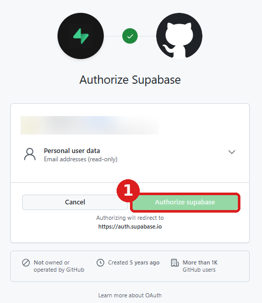

 Después hay que crear una **organization** (organización: el espacio de la institución en Supabase). A veces Supabase muestra el formulario solo; si no, abrir **supabase.com/dashboard/new**. **Sin organización no se puede crear la llave** (en el punto 2, la lista de organizaciones aparece vacía: «No results found»). En el formulario:
   - **Name** (nombre): viene escrito algo como «…'s Org»: **borrarlo** y escribir el nombre de la institución. 📝 **Anotalo ya en la hoja, casilla D1.**
   - **Type** (tipo): **Non-profit** (sin fines de lucro) o, si no está, **Personal**.
   - **Plan**: **Free - $0/month** (gratis).
   - Tocar **Create organization** (crear organización).

   - Si después ofrece **Create a new project** (crear un proyecto nuevo): **no** crear nada. Los proyectos (las bases de datos) los crea solo el botón «Instalar». Seguir con el punto 2. Si en algún momento pide tarjeta, **no cargarla**, y nunca tocar **Upgrade** (pasar a pago).

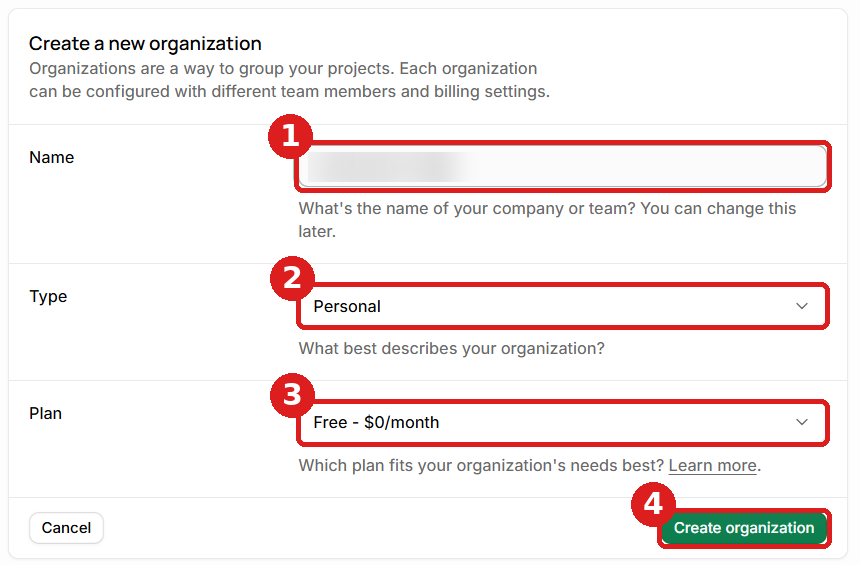

2. Crear la **llave** para el instalador. Camino corto: abrir **supabase.com/dashboard/account/tokens**. (Camino largo: arriba a la derecha, el ícono de la cuenta → **Account preferences** (preferencias de la cuenta) → **Access Tokens** (llaves de acceso).) Tocar **Generate new token** (crear una llave nueva; la parte verde del botón, no la flechita) y completar:

   - **Name** (nombre): «Instalador». **Expires in** (vence en): **Never** (nunca).
   - **Resource access** (a qué tiene acceso): **Organization** (organización) → elegir la organización.
   - **Permissions** (permisos): tocar «Preset · No access» → **Full access** (acceso completo). Aparece un aviso amarillo: es normal.
   - **Review access** (revisar). Aparece el «Step 2 of 2» (paso 2 de 2): una lista larga con etiquetas «READ-WRITE». **No hay que tocar nada**: tocar **Create token** (crear la llave), abajo a la derecha.

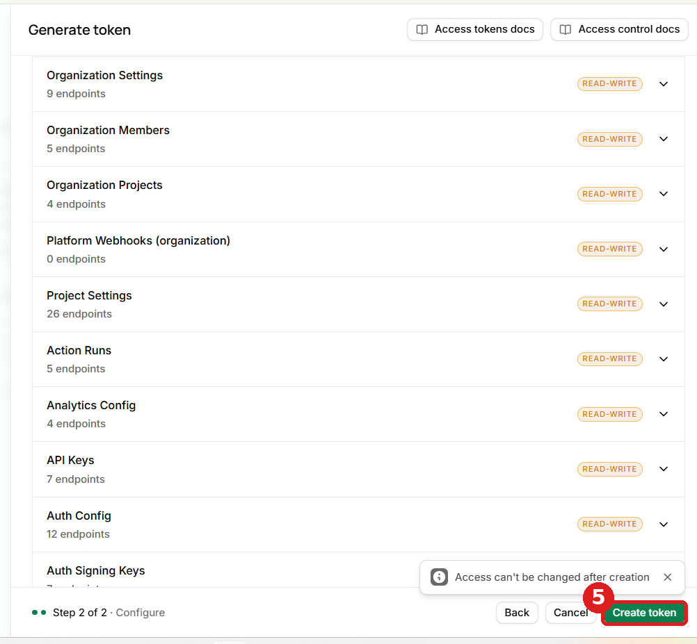

3. Copiar la llave (empieza con `sbp_`). **Se muestra una sola vez.** Dejar esa pestaña abierta y pegarla en el paso 6. ⛔ **Esta no se anota** (si se pierde, se crea otra).

> 📝 **Anotá en la hoja:** D1 (nombre de la organización de Supabase) y tildá D2 cuando la llave esté cargada en GitHub (paso 6).

> ✅ **Cómo sé que salió bien:** en supabase.com, arriba a la izquierda, se ve la organización con la etiqueta **FREE** (gratis), y en **Access Tokens** aparece «Instalador».

## Paso 5. La cuenta de Cloudflare y su llave

Cloudflare publica la aplicación en internet (una dirección como `inscripciones-laspalmas.pages.dev`).

1. Entrar a **dash.cloudflare.com/sign-up** (crear cuenta) y tocar **Continue with Google** (entrar con Google). Elegir **el Gmail de la institución** (el del paso 1) y aceptar. Así Cloudflare **no tiene contraseña propia** ni hace falta verificar el correo: se entra siempre con ese Gmail. 📝 **Tildá ya en la hoja la casilla E1.** Si aparece **Let us know you are human** (demostrá que sos una persona), se verifica solo («Verificando…»); si aparece una casilla, tildarla.

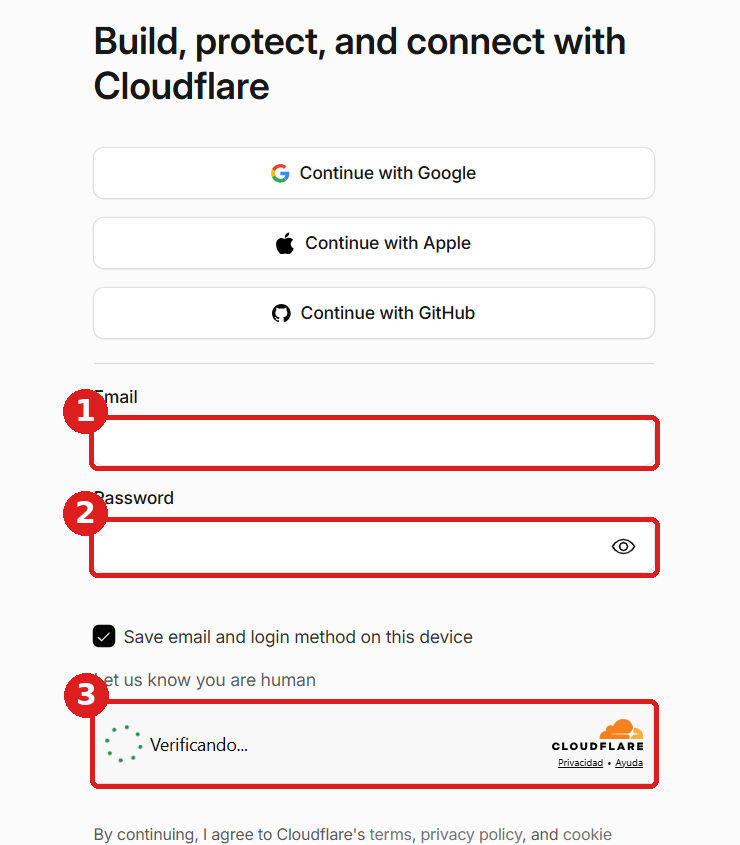

2. Si Cloudflare manda un correo pidiendo **Verify email** (verificar el correo), abrir el Gmail y tocar el enlace. Entrando con Google, normalmente no hace falta.
3. Si Cloudflare ofrece agregar un dominio (**Add a domain**), elegir un plan o hacer preguntas: **saltear** (**Skip**) o cerrar. No hace falta nada de eso, y nunca cargar tarjeta. Al terminar aparece la página de inicio («Ready when you are»): **no tocar** «Create app», «Add a domain» ni «Protect your app». Lo único que se usa está en el ícono de la persona, arriba a la derecha.

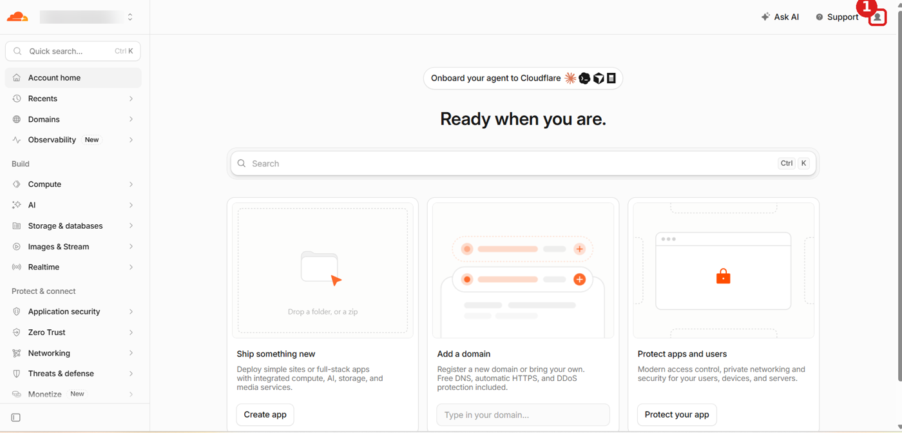

4. **Verificación en dos pasos:** no hace falta. Como se entra con Google, la protege la verificación en dos pasos del Gmail (paso 1).
5. Crear la **llave**. Camino corto: abrir **dash.cloudflare.com/profile/api-tokens**. (Camino largo: el **ícono de la persona** arriba a la derecha → **Profile** (perfil) → en el menú de la izquierda, **API Tokens** (llaves).) Tocar el botón azul **Create Token** (crear llave), arriba a la derecha. Se abre una lista de plantillas (API token templates): **no elegir ninguna**; bajar con la ruedita hasta el final, donde dice **Create Custom Token** (llave a medida), y tocar **Get started** (empezar). No hacer caso al cartel azul que recomienda «Account API Tokens»: se usa este botón **Create Token**, el azul de arriba a la derecha.

   - **Token name** (nombre): «Instalador».
   - **Permissions** (permisos), en la primera fila elegir: **Account** → **Cloudflare Pages** → **Edit** (editar). Tocar **+ Add more** (agregar otro) y en la segunda fila: **Account** → **Account Settings** → **Read** (leer).
   - **Account Resources** (cuentas): **Include** (incluir) → la cuenta de la institución (aparece como «…@gmail.com's Account»; si dice «All accounts», también sirve).
   - **Client IP address filtering** (filtrar por dirección): **dejarlo vacío**.
   - Si aparece **TTL** (fecha de vencimiento), dejarla vacía. Si obliga a poner una, elegir la más lejana y 📝 **anotarla ya en la hoja, casilla E2**.
   - Abajo: **Continue to summary** (ver resumen) → **Create Token** (crear llave).

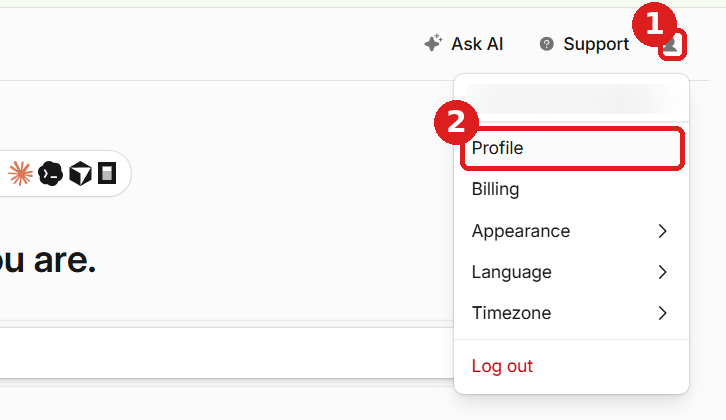

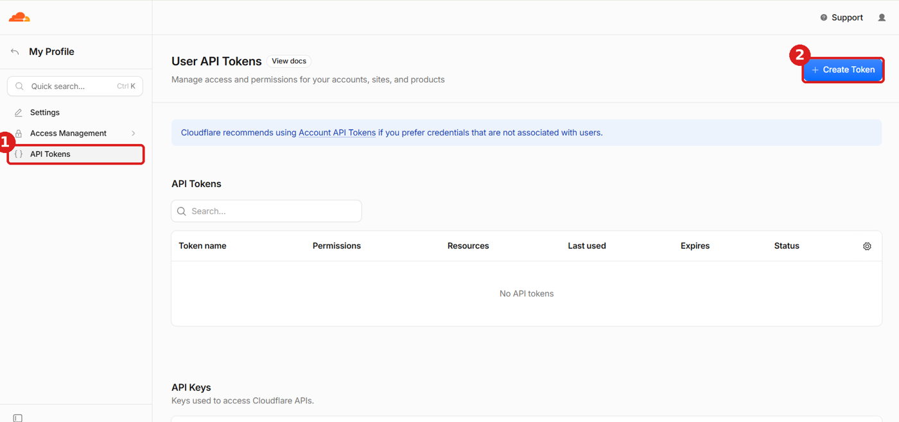

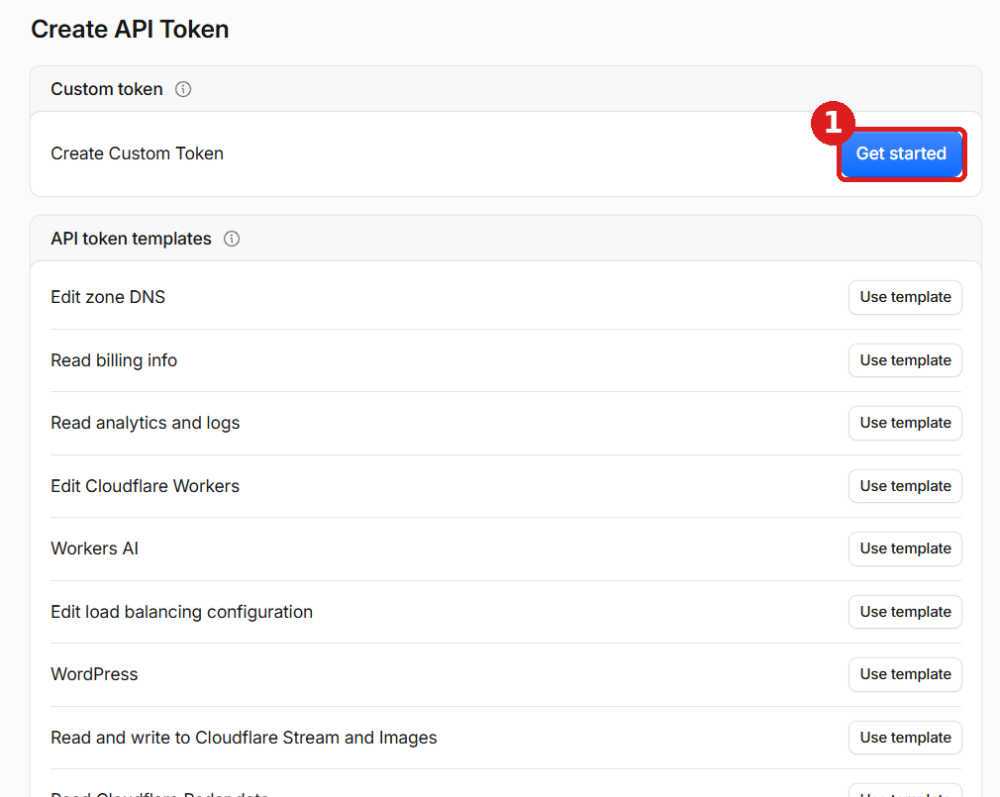

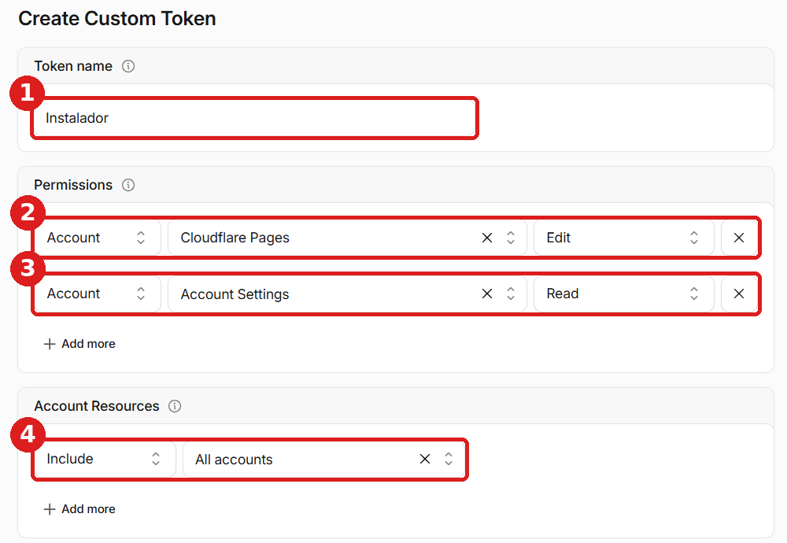

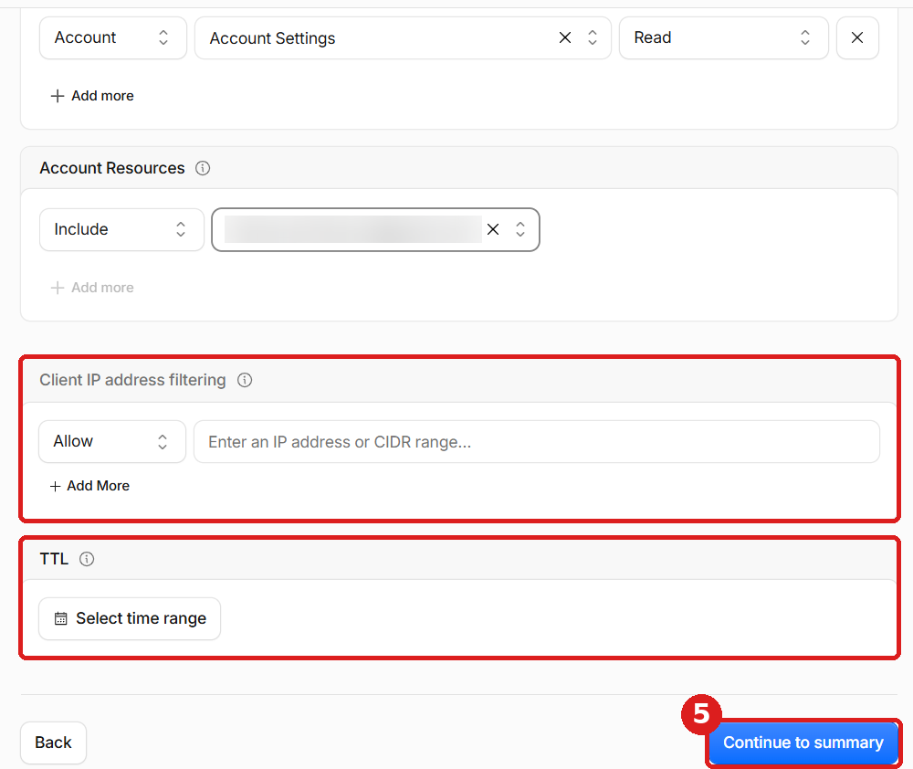

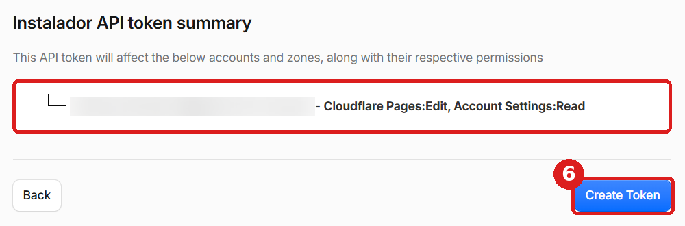

6. Aparece «Instalador API token was successfully created» (la llave se creó). **La llave es el texto del primer recuadro, el de línea punteada, que empieza con `cfut_`.** Copiarla con el iconito de dos cuadraditos de la derecha de ese recuadro. **No** copiar el recuadro de abajo («Test this token», el que empieza con `curl`): eso es para técnicos. **Se muestra una sola vez.** Dejar esa pestaña abierta y pegarla en el paso 6. ⛔ **Esta no se anota** (si se pierde, se crea otra).

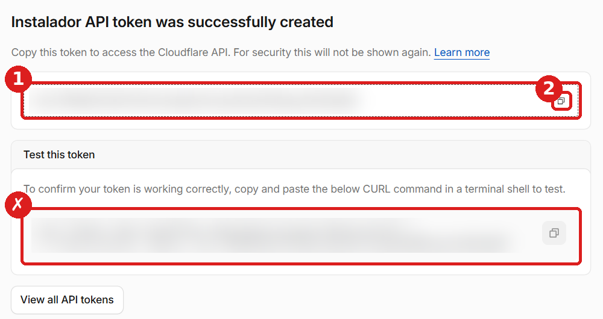

> 📝 **Revisá en la hoja:** E1 tildada (se entra con Google) y E2 (vencimiento de la llave, si tiene).

> ✅ **Cómo sé que salió bien:** en **Profile → API Tokens** aparece «Instalador» con estado **Active** (activa).

## Paso 6. Cargar las cuatro claves en GitHub

> 🔑 **Si saliste de GitHub o cerraste la página:** entrar a **github.com/login** → escribir el usuario (casilla C1) o el Gmail de la institución, y la contraseña (C2) → **Sign in** (entrar) → GitHub pide un número de **6 dígitos**: abrir **Google Authenticator** en el celular (C3) y escribir el número que dice «GitHub». Si Chrome ofrece completar la contraseña, sirve igual.

**Cómo llegar a la página de las claves:**

**Camino A, escribiendo la dirección:** en Chrome, hacé clic en la barra de direcciones de arriba, borrá lo que haya y escribí, **cambiando USUARIO por el usuario de GitHub de la institución** (casilla C1):
**github.com/USUARIO/app-inscripciones/settings/secrets/actions**
(por ejemplo: github.com/inscripciones-laspalmas/app-inscripciones/settings/secrets/actions) y apretá **Enter**. Si dice «404 – Page not found», revisá el usuario o usá el camino B.

**Camino B, tocando:** entrar a **github.com** → a la izquierda, en **Top repositories**, tocar **app-inscripciones** → arriba, en la fila de pestañas, tocar **Settings** (configuración; la última, con un engranaje) → en el menú de la izquierda, bajar hasta **Secrets and variables** (secretos y variables) → **Actions**.

**Llegaste bien si ves** el título **Actions secrets and variables** y, abajo, **Repository secrets** con el botón verde **New repository secret**.

**Cargar las claves:**

1. Para cada una de las cuatro claves de la tabla: tocar el botón verde **New repository secret** (nuevo secreto) → en **Name** (nombre) escribir el nombre **exactamente** así, con mayúsculas y guiones bajos → en **Secret** (secreto) pegar el valor → **Add secret** (agregar). **No** usar «Manage environment secrets» (es otra cosa): siempre el botón verde **New repository secret**, de la parte de abajo.

| Nombre | Qué se pega |
|---|---|
| `SUPABASE_ACCESS_TOKEN` | La llave de Supabase (paso 4) |
| `CLOUDFLARE_API_TOKEN` | La llave de Cloudflare (paso 5) |
| `CLAVE_RESPALDO` | Una clave **inventada** y larga (mínimo 16 caracteres; por ejemplo, cuatro palabras con números). **Sin ella no se pueden abrir los respaldos** |
| `GMAIL_CLAVE_APLICACION` | La contraseña de aplicación de 16 letras (paso 1, casilla B6). Da lo mismo con o sin los espacios del medio |

> GitHub guarda los secrets cifrados y no los vuelve a mostrar. Si uno se carga mal, se vuelve a crear con el mismo nombre (reemplaza al anterior).

> 📝 **Anotá en la hoja:** F1 (la CLAVE_RESPALDO, letra por letra: es la más importante). **Anotala antes de pegarla en GitHub**: después GitHub no la deja ver nunca más, así que la hoja es la única copia. No es una cuenta: no tiene dirección web ni usuario. Tildá también D2 y E3.

> ✅ **Cómo sé que salió bien:** en **Secrets and variables → Actions**, debajo de **Repository secrets**, se ven los **cuatro nombres** de la tabla, escritos igual. (El valor no se ve nunca: es normal.)

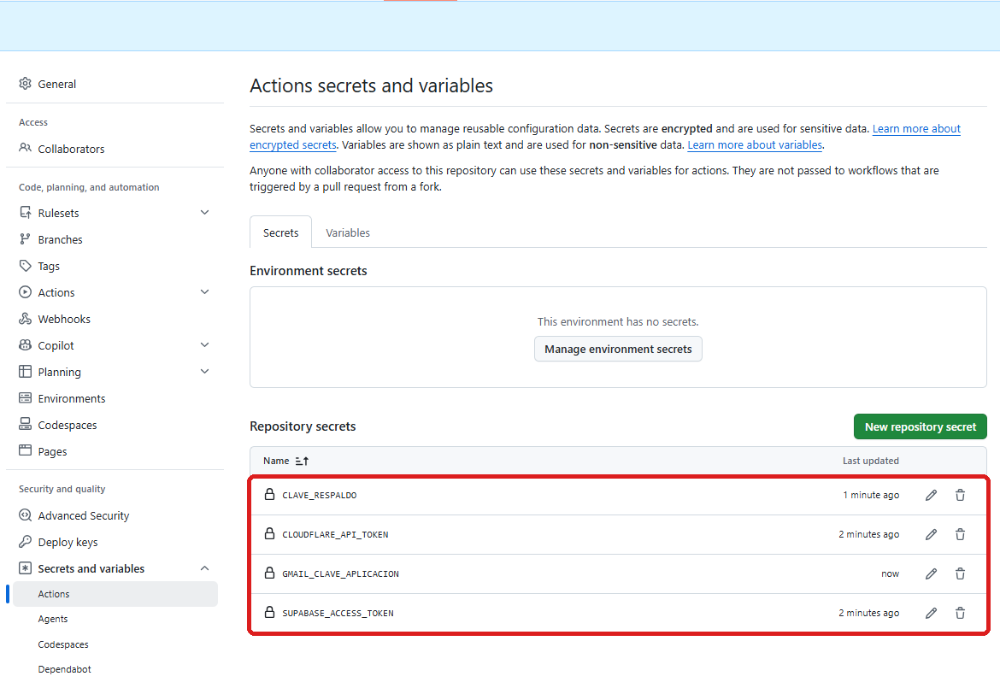

## Paso 7. El botón «Instalar»

**Cómo llegar a la página de «Instalar»** (hay dos caminos; usá el que te resulte más fácil):

**Camino A, escribiendo la dirección:**

1. En Chrome, hacé clic en la barra de direcciones de arriba (donde se escriben las páginas), borrá lo que haya y escribí, **cambiando USUARIO por el usuario de GitHub de la institución** (casilla C1):
   **github.com/USUARIO/app-inscripciones/actions/workflows/instalar.yml**
   Por ejemplo: github.com/inscripciones-laspalmas/app-inscripciones/actions/workflows/instalar.yml. Apretá **Enter**.
2. Si aparece la página para entrar a GitHub, ver «🔑 Si saliste de GitHub» en el paso 6 y después volvé a escribir la dirección.
3. Si dice **«404 – Page not found»** (página no encontrada): la dirección quedó mal escrita (revisá el usuario, C1) o no entraste a GitHub. Probá el camino B.

**Camino B, tocando:**

1. Entrar a **github.com** (si pide entrar, ver «🔑 Si saliste de GitHub» en el paso 6).
2. A la izquierda aparece la lista **Top repositories** (tus repositorios): tocar **app-inscripciones**. (Si no la ves, tocá el ícono ☰ de arriba a la izquierda y buscala ahí.)
3. Arriba, en la fila de pestañas (Code, Issues, Pull requests, **Actions**…), tocar **Actions** (acciones: las tareas automáticas).

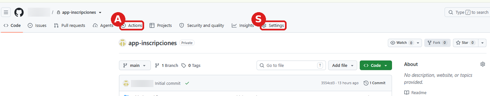

4. En la lista de la izquierda, tocar **Instalar**. (A la derecha puede haber filas en verde ✅ de otras tareas, como «Respaldo diario»: es normal, corren solas.)

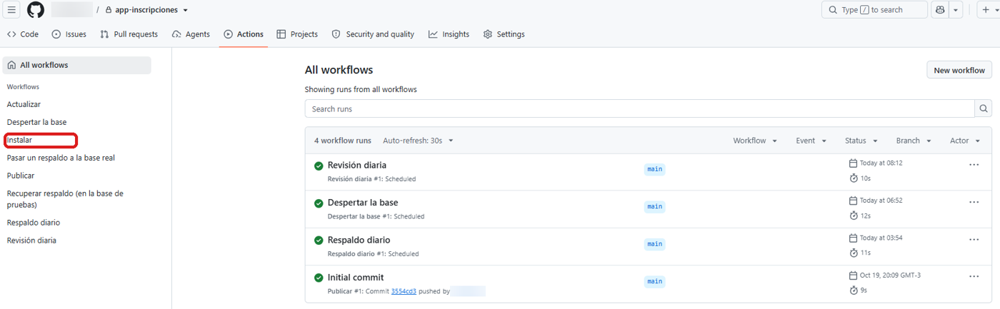

**Llegaste bien si ves** arriba el título **Instalar**, a la derecha el botón verde **Run workflow** y abajo «This workflow has no runs yet» (todavía no se usó: es normal). Si en lugar de eso aparece un cartel con el botón **I understand my workflows, go ahead and enable them** (entiendo, activalas), tocarlo y volver a tocar **Instalar** en la lista de la izquierda.

**Ahora sí, instalar:**

1. Tocar el botón verde **Run workflow** (ejecutar), arriba a la derecha. Se abre un panel a la derecha de la pantalla.
2. Completar los cuatro casilleros del panel, **copiando de la hoja de accesos** (**Use workflow from: main** se deja como está):

| Casillero del panel | Qué poner | De dónde sale |
|---|---|---|
| **Nombre de la institución** | El nombre como se va a ver en la aplicación (ej.: «Club Atlético Las Palmas») | Hoja de accesos, arriba: **Institución** |
| **Gmail de la institución** | El Gmail creado en el paso 1 | Casilla **B1** |
| **Correo del primer Responsable general** | El correo con el que esa persona va a entrar al panel (puede ser su correo personal o el mismo Gmail de la institución); tiene que poder recibir correos | Casilla **A2** (si está vacía, 📝 **anotalo ya**) |
| **Nombre y apellido del Responsable general** | Su nombre y apellido | Casilla **A1** |

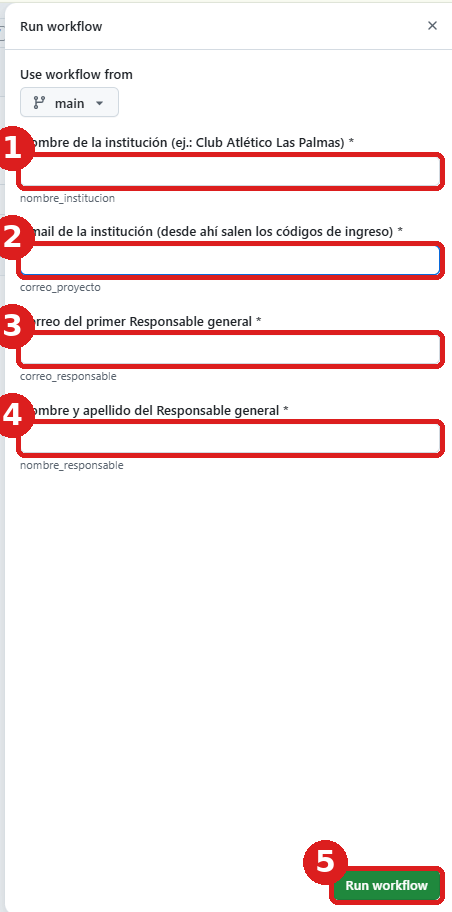

3. Tocar el botón verde **Run workflow** de **abajo de todo** del panel. A los pocos segundos aparece una fila nueva con un círculo amarillo 🟡 (está trabajando; si no aparece, recargar la página con F5). Tarda entre **5 y 15 minutos**: no hace falta quedarse mirando. Tocando esa fila se ve el detalle: **Status** (estado) dice **Queued** (en espera) y después **In progress** (trabajando). **No** tocar **Cancel workflow** (cancelar).

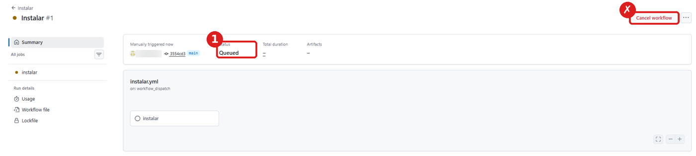

4. Cuando termina, el círculo se pone verde ✅ y **Status** dice **Success** (éxito). Bajando un poco aparece el **resumen** «Instalación terminada» con la dirección de la aplicación y la del panel. 📝 **Anotá ya en la hoja: G1 (fecha de hoy), G2 (dirección de la aplicación) y G3 (dirección del panel).**

**Qué hace solo el instalador:** crea las dos bases de datos (real y de pruebas), carga todas las tablas y reglas de seguridad, da de alta al Responsable general, configura los correos con el código de ingreso y publica la aplicación. Desde ese momento, todos los días se hace un **respaldo cifrado** y el sistema **se revisa solo** y avisa por correo si algo necesita atención.

**Si termina en rojo ❌:** abrir la ejecución y leer el mensaje en rojo: dice qué falta (por ejemplo, una llave mal copiada). Corregir y volver a tocar **Run workflow**: lo que ya se hizo no se repite.

> 📝 **Anotá en la hoja:** A (datos del Responsable general), G1 (fecha), G2 (dirección de la aplicación) y G3 (dirección del panel, la que termina en `/#panel`).

> ✅ **Cómo sé que salió bien:** la ejecución está en verde ✅ y, al abrir la dirección de la aplicación en el navegador, aparece la pantalla para activar un QR.

## Paso 8. Primer ingreso al panel

1. Abrir la dirección del panel (G3) en la computadora.
2. Escribir el correo del Responsable general → **Enviarme el código** → escribir el código de 6 números que llega por correo (la primera vez, mirar en **Spam** o **Promociones**).

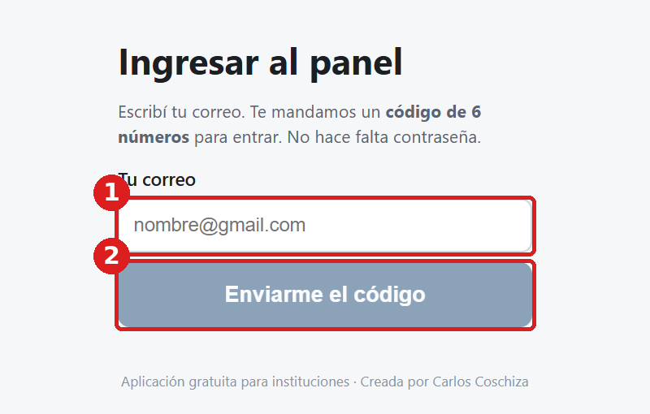

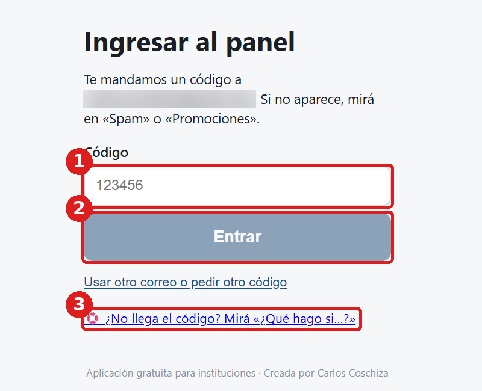

3. Arriba del Resumen aparece la lista **Primeros pasos**. Seguí el documento **3 · Después de instalar**.

> ✅ **Cómo sé que salió bien:** entrás al panel y arriba dice «Hola, *tu nombre* · Responsable general».

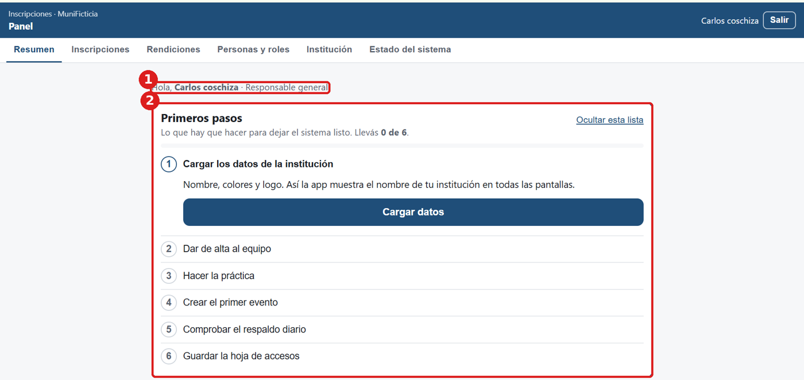

---

## Si algo sale mal durante la instalación

| Qué pasa | Qué hacer |
|---|---|
| El instalador dice «Faltan datos: …» | El mensaje dice cuál falta: una clave en GitHub (revisar el paso 6: el nombre tiene que estar escrito exactamente igual) o un casillero del panel de «Instalar» |
| «Cloudflare respondió 403» o «Supabase respondió 401» | La llave está mal copiada o no tiene los permisos de los pasos 4 o 5. Crear una nueva y cargarla otra vez |
| «La base … tardó demasiado en estar lista» | Supabase está lento. Esperar unos minutos y volver a tocar **Run workflow** |
| «Supabase no deja crear más bases gratis…» | Se creó un proyecto a mano en Supabase. Borrarlo (supabase.com → el proyecto → **Project Settings** → **General** → abajo, **Delete project**) y volver a tocar **Run workflow** |
| No llega el código de ingreso | Mirar en Spam. Revisar la contraseña de aplicación del Gmail (paso 1) y volver a instalar |
| «Este correo no está habilitado» | Ese correo no es el que se puso como Responsable general en el paso 7 |
| Google bloqueó el Gmail por intentos | Esperar unas horas y entrar con el correo de recuperación (B4) |

Los problemas del uso diario están en **6 · ¿Qué hago si…?**

---

## Cómo se usa una tarea automática de GitHub (Actions)

Instalar, actualizar, despertar la base, recuperar un respaldo: **todas se usan igual**.

1. Entrar a la dirección del repositorio (casilla C5) → pestaña **Actions** (arriba).
2. En la lista de la izquierda, tocar la tarea (por ejemplo **Despertar la base**).
3. Arriba a la derecha, botón verde **Run workflow** (ejecutar) → se abre un panel a la derecha.
4. Si el panel tiene casilleros, completarlos. **Use workflow from: main** se deja como está.
5. Abajo de todo del panel, otra vez el botón verde **Run workflow**.
6. Aparece una fila nueva (si no aparece, F5). El círculo dice cómo va:

| Se ve | Quiere decir | Qué hacer |
|---|---|---|
| 🟡 círculo amarillo que gira | Está trabajando | Esperar. Se puede cerrar la página |
| ✅ verde | Terminó bien | Nada. Tocando la fila se ve el resumen |
| ❌ rojo | Algo falló | Tocar la fila: el mensaje en rojo dice qué pasó y qué hacer |
| ⚪ gris («Queued», en espera) | GitHub todavía no la empezó | Esperar unos minutos: a veces GitHub tarda |

> ⚠️ Para volver a intentar después de un ❌, usá siempre **Run workflow** (los pasos 3 a 5), **no** «Re-run jobs» (repite la ejecución vieja, con los datos viejos).

> Si arriba aparece un cartel amarillo **«This scheduled workflow is disabled…»** (la tarea está apagada) con el botón **Enable workflow** (activar), tocarlo. No debería pasar: el sistema las mantiene encendidas solo.

---

## Mantenimiento (después de instalar)

- **El sistema se revisa solo** todos los días a la mañana y, si algo necesita atención, manda un correo **en castellano** a los Responsables generales, con qué hacer. En el panel: **Estado del sistema**.
- **Respaldos:** todos los días a la madrugada, cifrados con la CLAVE_RESPALDO (F1). Para recuperar uno: GitHub → **Actions** → **Recuperar respaldo (en la base de pruebas)**; para pasarlo a la base real, **Pasar un respaldo a la base real** (pide escribir REEMPLAZAR LA BASE REAL y se puede deshacer).
- **Actualizaciones:** cuando salga una versión nueva, GitHub → **Actions** → **Actualizar** → **Run workflow** (botón verde de arriba a la derecha y, en el panel, **Run workflow** de abajo de todo). No se pierden datos. Si el panel dice «La base de datos está desactualizada», es la señal de que hay que tocarlo.
- **Si vence una llave:** crear una nueva (pasos 4 o 5) y cargarla en GitHub con el mismo nombre (paso 6). Anotar el vencimiento nuevo (E2).
- **Si una base se «duerme»:** no hay que hacer nada (se despierta sola dos veces por día). Con apuro: GitHub → **Actions** → **Despertar la base** → **Run workflow** (botón verde de arriba a la derecha y, en el panel, **Run workflow** de abajo de todo). Ver la tabla de abajo.
- **Si cambia el Responsable general:** el nuevo se da de alta en **Personas y roles** y se le entrega esta carpeta y la Hoja de accesos.

## Si una base se «duerme» (pausa del plan gratuito): qué hacer en cada caso

El plan gratuito de Supabase pausa una base que no se usa durante una semana. **El sistema lo resuelve solo**: dos veces por día (a las 6 y a las 18) revisa las dos bases, despierta la que esté pausada y les hace una consulta mínima para que no se vuelvan a pausar. También evita que GitHub apague las tareas automáticas por falta de cambios.

| Qué pasa | Qué hacer |
|---|---|
| No pasa nada raro | **Nada.** El sistema mantiene las bases despiertas solo |
| Llega un correo: «La base … estaba pausada y se despertó sola» | **Nada.** Ya está resuelto y no se perdió nada |
| El panel no conecta o dice que la base está «dormida» | **Esperar**: se despierta sola en unas horas. Los celulares siguen cargando y envían todo después |
| …y hay apuro (por ejemplo, es el día del evento) | GitHub → **Actions** → **Despertar la base** → **Run workflow** (botón verde de arriba a la derecha y, en el panel, **Run workflow** de abajo de todo). Esperar el verde ✅ (5 a 10 minutos) y actualizar el panel (F5) |
| «Despertar la base» termina en rojo ❌ y habla de la «llave de Supabase» | Crear una llave nueva (paso 4) y cargarla en GitHub con el mismo nombre, `SUPABASE_ACCESS_TOKEN` (paso 6). Volver a tocar **Run workflow** |
| «Despertar la base» termina en rojo ❌ por otro motivo | supabase.com → abrir el proyecto → **Resume project** (el botón blanco; **nunca** «Upgrade to Pro», que es pago) |

