# Instalación paso a paso

**Para quién es:** para la persona de la institución que va a poner en marcha el sistema. No hace falta saber de tecnología: hay que seguir los pasos **en orden**, sin saltear ninguno.

**Qué hace falta:**

- Una **computadora** con internet y el navegador **Chrome**.
- Un **celular** (para la verificación en dos pasos y la app **Google Authenticator**).
- Entre **1 hora y 1 hora y media**, sin apuro. **Se puede hacer en partes**: al terminar cada paso, se puede frenar y seguir otro día.
- La **Hoja de accesos** (documento 1) **impresa** y una lapicera. Las contraseñas y claves se anotan **solo ahí, a mano**: nunca en la computadora, en el correo ni en WhatsApp.

**Cómo es:**

1. **A mano (pasos 1 a 6):** crear las cuentas que los servicios exigen que cree una persona y copiar cuatro claves.
2. **Automático (paso 7):** tocar el botón **Instalar**. El sistema hace todo lo demás.
3. **Desde la aplicación (paso 8):** seguir la lista **Primeros pasos** del panel.

> **Regla de oro:** cada servicio lleva **una contraseña distinta**. Todas van a la Hoja de accesos.

> 📝 En cada paso, el recuadro **«Anotá en la hoja»** dice qué casillas completar (por ejemplo, **B2**). El recuadro **«✅ Cómo sé que salió bien»** dice qué tiene que aparecer antes de seguir.

---

## Paso 1. El Gmail de la institución

Todas las cuentas quedan a nombre de este correo, no de una persona. Si mañana otra persona se hace cargo, se le entrega este acceso.

1. Entrar a **accounts.google.com/signup**.
2. Nombre: algo que identifique a la institución (por ejemplo «Inscripciones» «Club Las Palmas»).
3. Dirección: por ejemplo **inscripciones.laspalmas@gmail.com**.
4. Contraseña larga y nueva.
5. Teléfono: el celular del Responsable general.
6. **Correo de recuperación:** agregar el correo personal del Responsable general (**myaccount.google.com → Seguridad → Correo de recuperación**). Evita quedar bloqueado.

**Verificación en dos pasos (obligatoria):**

1. Entrar a **myaccount.google.com/security** y tocar **Verificación en dos pasos**.
2. **Mirá qué aparece:**
   - Si hay un botón **«Comenzar»** o **«Activar»**: tocarlo, cargar el celular y escribir el código que llega por SMS.
   - Si aparece una lista (Llaves de acceso, Notificación de Google, Authenticator, **Número de teléfono** con un ✅ verde, **Códigos de verificación alternativos**) y abajo el botón **«Desactivar la verificación en dos pasos»**: **ya está activada**. No hace falta ningún SMS; seguí con el punto 3. (Pasa cuando el celular ya estaba cargado en la cuenta.)
3. Tocar **«Códigos de verificación alternativos»** (la última fila) → **Obtener códigos**. Aparecen **10 códigos de 8 números**: copiarlos a mano en la hoja.

> **Si el SMS no llega:** revisá el número: en Argentina va **+54 9** y la característica sin 0 y sin 15 (por ejemplo, +54 9 362 4555666). Elegí **«Llamada de voz»** para que Google te dicte el código. Esperá 2 o 3 minutos antes de pedir otro. Si sigue sin llegar, usá otro número o probá unas horas más tarde (Google limita los códigos a un número que ya está en varias cuentas).

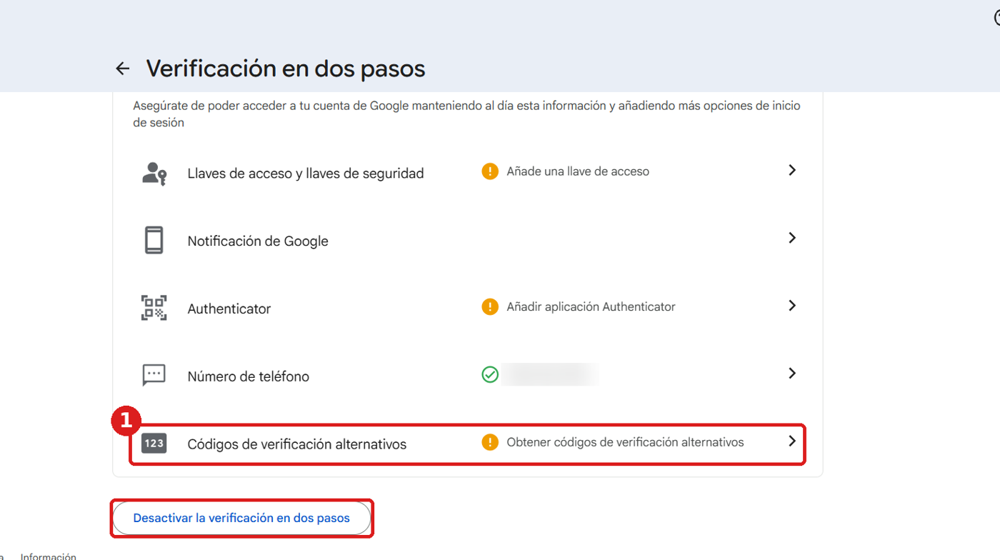

> Si Google pide «escaneá este QR con tu celular»: usar los **datos móviles** del celular (no el Wi-Fi) y no reintentar muchas veces seguidas; después de varios intentos, Google bloquea el acceso por unas horas.

**Contraseña de aplicación** (para que el sistema pueda mandar los códigos de ingreso por correo):

1. Con la sesión del Gmail de la institución abierta, entrar a **myaccount.google.com/apppasswords**.
2. Nombre: «Supabase» → **Crear**.
3. Aparece una clave de **16 letras**. Se usa en el paso 6.

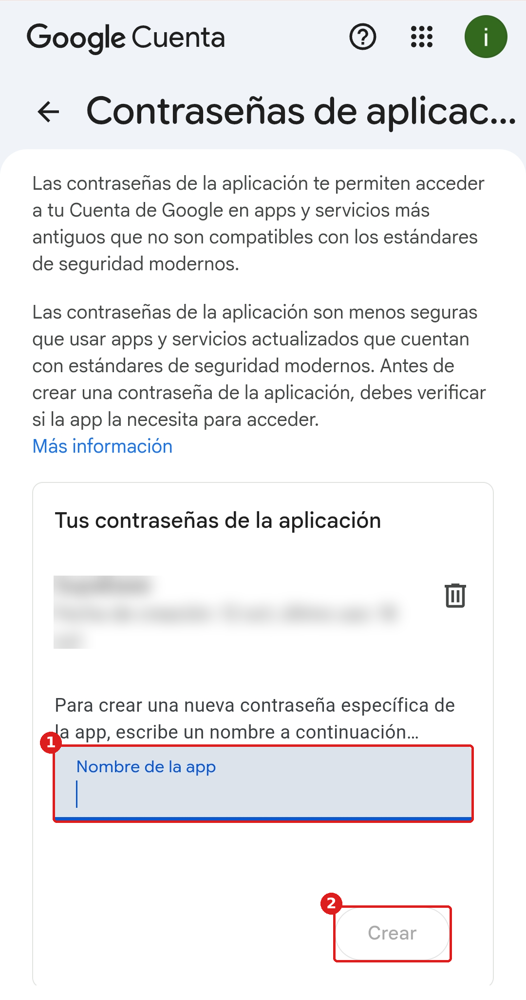

> Si la página dice que no está disponible, la verificación en dos pasos todavía no quedó activa: esperar unos minutos y volver a probar.

> 📝 **Anotá en la hoja:** B1 (dirección), B2 (contraseña), B3 (celular), B4 (correo de recuperación), B5 (códigos de seguridad) y B6 (contraseña de aplicación de 16 letras).

> ✅ **Cómo sé que salió bien:** abrí una **ventana de incógnito** (Ctrl + Shift + N), entrá a **gmail.com** con la dirección y la contraseña: tiene que pedir **un segundo paso** (un código o una confirmación en el celular).

## Paso 2. La cuenta de GitHub

GitHub guarda el programa de la aplicación y hace las tareas automáticas (instalar, publicar, respaldos, revisión diaria).

> 🌐 **GitHub, Supabase y Cloudflare están en inglés.** No hace falta saber inglés: en este manual, cada botón aparece **en negrita, tal cual se ve en la pantalla**, y al lado, entre paréntesis, qué quiere decir. **No uses el traductor de Chrome** en estas páginas: cambia los nombres de los botones y ya no coinciden con el manual.

> ✋ **Regla general: si aparece un casillero, una opción o una pregunta que el manual no nombra, dejalo como está** (vacío o con lo que ya trae) y seguí. Solo hay que tocar lo que el manual dice.

> 🤖 **«¿Sos un robot?»** Al registrarte o entrar, GitHub (y también Google o Cloudflare) a veces muestra un control para comprobar que sos una persona: **deslizar una flecha hacia la derecha** (en inglés dice «Verification Required» y «Slide right to secure your access»: es lo mismo), elegir imágenes o resolver un pequeño juego. Es normal y no tiene nada que ver con la aplicación: hacé lo que pide, despacio. Si sale mal, aparece otro; probá de nuevo. Con el botón del parlante 🔊 se puede hacer escuchando.

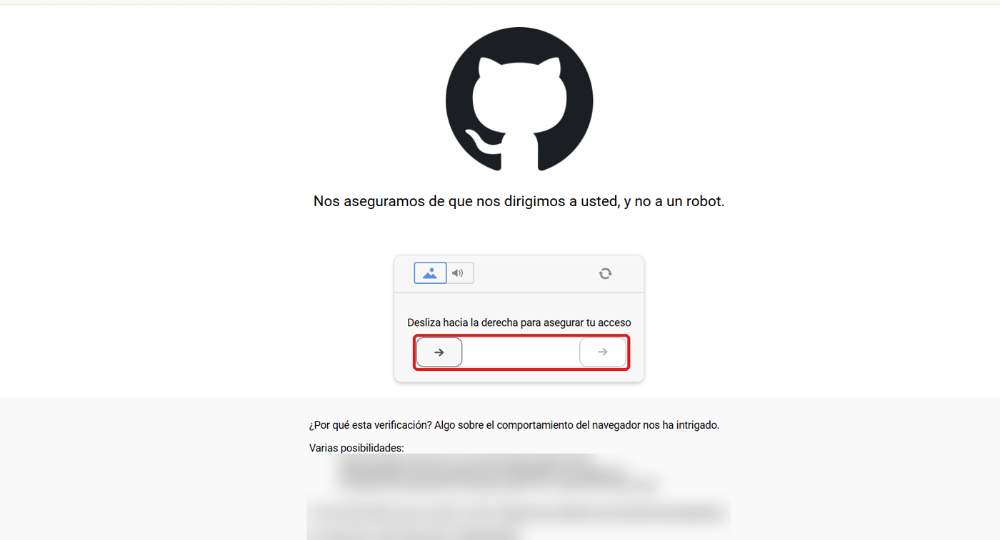

1. Entrar a **github.com/signup** (página para crear una cuenta).
2. Completar, uno por uno, lo que pide la pantalla:
   - **Email** (correo): el Gmail de la institución.
   - **Password** (contraseña): una **contraseña nueva**, distinta de la del Gmail. GitHub pide **15 caracteres o más** (o al menos 8 con algún número y alguna minúscula).
   - **Username** (nombre de usuario): por ejemplo **inscripciones-laspalmas** (letras, números y guiones; sin espacios). Si dice que ya existe, agregale algo (por ejemplo, la ciudad).
   - **Your Country/Region** (país): Argentina.
   - **No** usar los botones «Continue with Google» ni «Continue with Apple»: completar los casilleros. La casilla **Email preferences** (recibir novedades) se deja sin tildar.
   - Tocar **Create account** (crear cuenta).

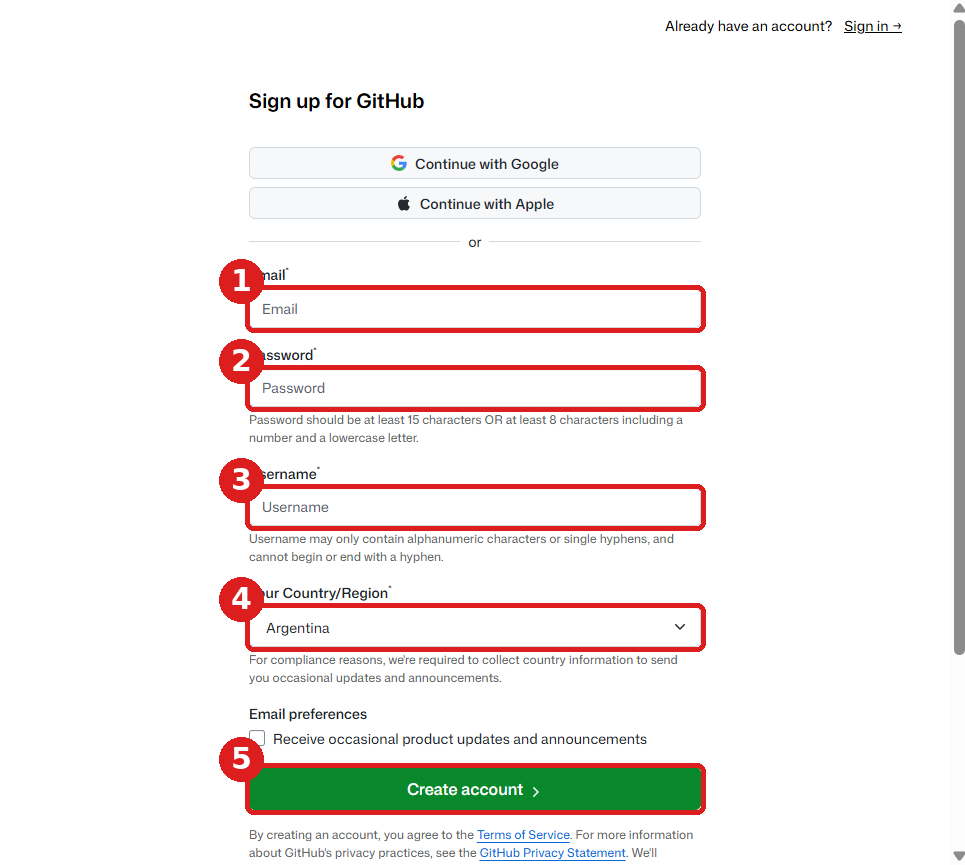
3. Aparece el control **«¿sos un robot?»** (ver arriba). Resolverlo.
4. GitHub manda un **código de 8 números al Gmail**: abrir el Gmail, copiarlo y escribirlo en GitHub.
5. Si pregunta por un plan, elegir **Free** (gratis). Si hace preguntas sobre para qué lo vas a usar, se pueden saltear con **Skip** (saltear) o **Continue** (continuar).
6. **Verificación en dos pasos** (obligatoria): tocar la **foto de perfil** (el círculo de arriba a la derecha) → **Settings** (configuración) → en el menú de la izquierda, **Password and authentication** (contraseña y autenticación) → **bajar con la ruedita del mouse** hasta el título **Two-factor authentication** (verificación en dos pasos) → botón verde **Enable two-factor authentication** (activar).

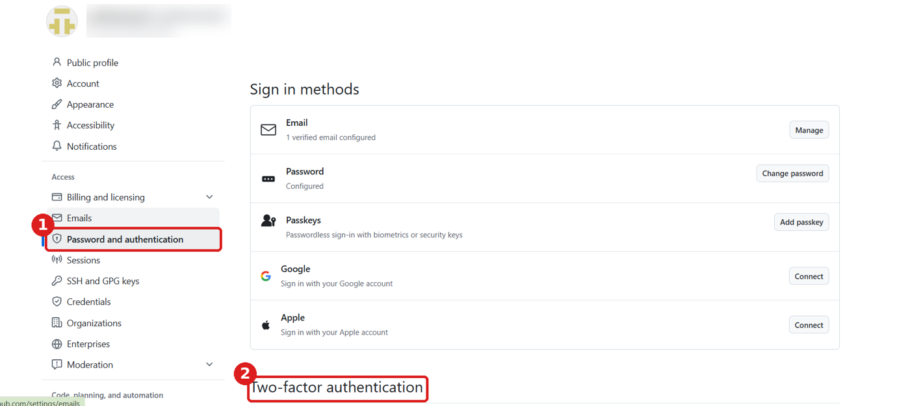
 A veces GitHub ya la pide sola al registrarte: es lo mismo.
7. Elegir **Authenticator app** (aplicación de autenticación). En el celular, instalar **Google Authenticator** (desde Play Store o App Store), abrirla, tocar **+** → **Escanear un código QR** y apuntar a la pantalla de la computadora. En el celular aparece un número de **6 dígitos** que cambia cada 30 segundos: escribirlo en GitHub y tocar **Continue**.
8. GitHub muestra los **recovery codes** (códigos de recuperación, sirven si perdés el celular). Tocar **Download** (descargar) e imprimirlos, o copiarlos a mano. Después tocar **I have saved my recovery codes** (ya guardé mis códigos) y **Done** (listo).

> 📝 **Anotá en la hoja:** C1 (usuario), C2 (contraseña), C3 (en qué celular está Google Authenticator) y C4 (dónde guardaste los recovery codes).

> ✅ **Cómo sé que salió bien:** tocá la foto de perfil → **Sign out** (cerrar sesión) y volvé a entrar en **github.com/login**: tiene que pedir la contraseña **y** el número de 6 dígitos de Google Authenticator.

## Paso 3. La copia de la aplicación

1. Con la sesión de GitHub de la institución abierta, entrar a la **plantilla**: **github.com/inscripciones-iglesia/app-inscripciones-plantilla**. (Es el molde que copian **todas** las instituciones, sean o no iglesias: no tiene datos de nadie, y la copia que hacés queda en tu cuenta, privada.)
2. Tocar el botón verde **Use this template** (usar esta plantilla) → **Create a new repository** (crear un repositorio nuevo; «repositorio» es la carpeta donde GitHub guarda la aplicación).

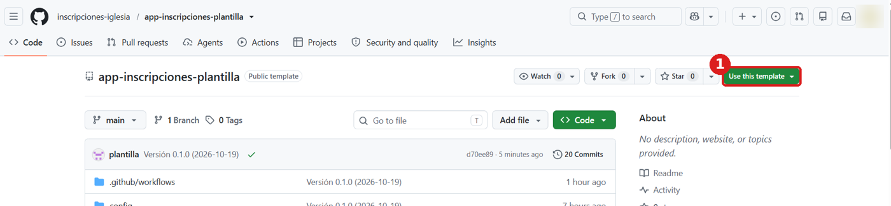

3. Completar:
   - **Owner** (dueño): la cuenta de la institución (ya aparece elegida).
   - **Repository name** (nombre): **app-inscripciones**.
   - **Description** (descripción): dejarlo **vacío**.
   - **Include all branches** (incluir todas las ramas), si aparece: **no tildarlo**.
   - **Choose visibility** (quién lo puede ver): **viene en «Public»; hay que cambiarlo**: tocar «Public» y elegir **Private** (privado: solo lo ve la institución).
   - Tocar **Create repository** (crear repositorio) y esperar unos segundos.

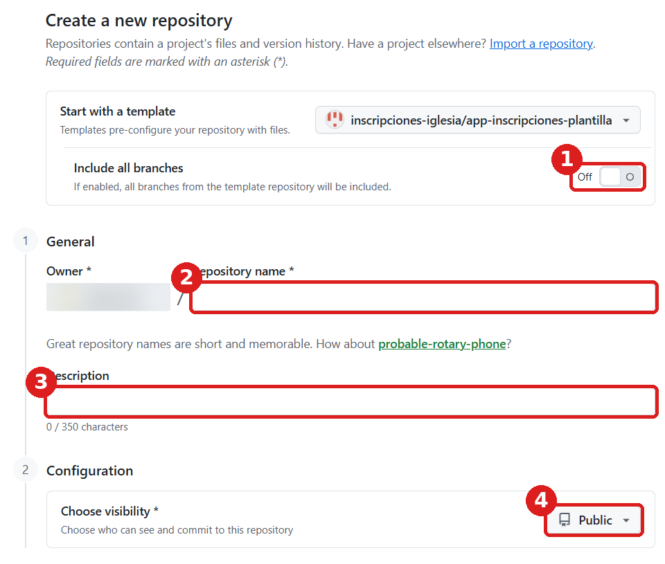

> 📝 **Anotá en la hoja:** C5 (la dirección del repositorio, por ejemplo github.com/inscripciones-laspalmas/app-inscripciones).

> ✅ **Cómo sé que salió bien:** arriba a la izquierda dice **inscripciones-laspalmas / app-inscripciones** con la etiqueta **Private**.

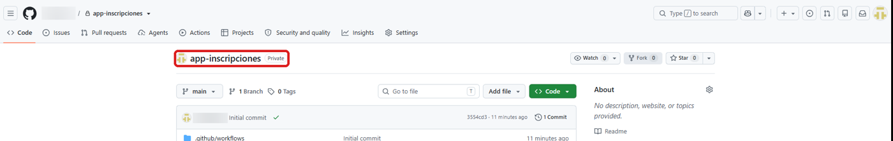

## Paso 4. La cuenta de Supabase y su llave

Supabase es donde van a estar las bases de datos (la real y la de pruebas). **No hace falta crearlas a mano**: lo hace el instalador.

1. Entrar a **supabase.com/dashboard/sign-in** → tocar **Continue with GitHub** (entrar con la cuenta de GitHub que creaste en el paso 2; **no** completar Email ni Password, aunque Chrome los llene solo) → **Authorize** (autorizar). Queda creada una «organización» (el espacio de la institución en Supabase) con plan **Free** (gratis). Si pregunta un nombre para la organización, poner el de la institución. Si en algún momento pide tarjeta, **no cargarla**, y nunca tocar **Upgrade** (pasar a pago).

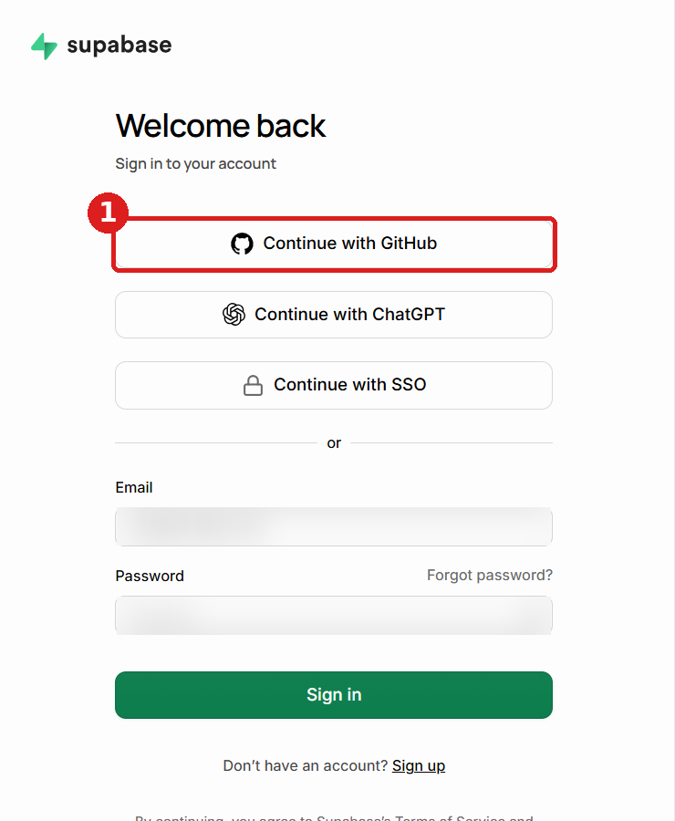

2. Crear la **llave** para el instalador. Camino corto: abrir **supabase.com/dashboard/account/tokens**. (Camino largo: arriba a la derecha, el ícono de la cuenta → **Account preferences** (preferencias de la cuenta) → **Access Tokens** (llaves de acceso).) Tocar **Generate new token** (crear una llave nueva; la parte verde del botón, no la flechita) y completar:

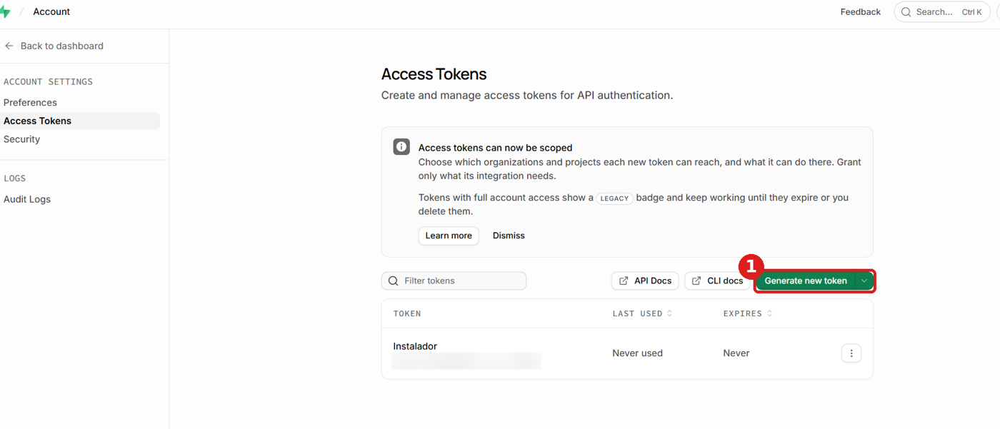

   - **Name** (nombre): «Instalador». **Expires in** (vence en): **Never** (nunca).
   - **Resource access** (a qué tiene acceso): **Organization** (organización) → elegir la organización.
   - **Permissions** (permisos): tocar «Preset · No access» → **Full access** (acceso completo). Aparece un aviso amarillo: es normal.
   - **Review access** (revisar) → confirmar.

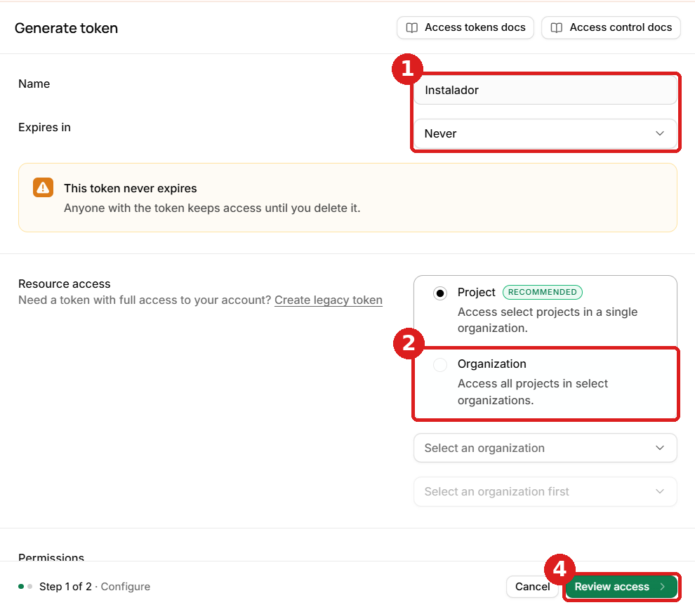

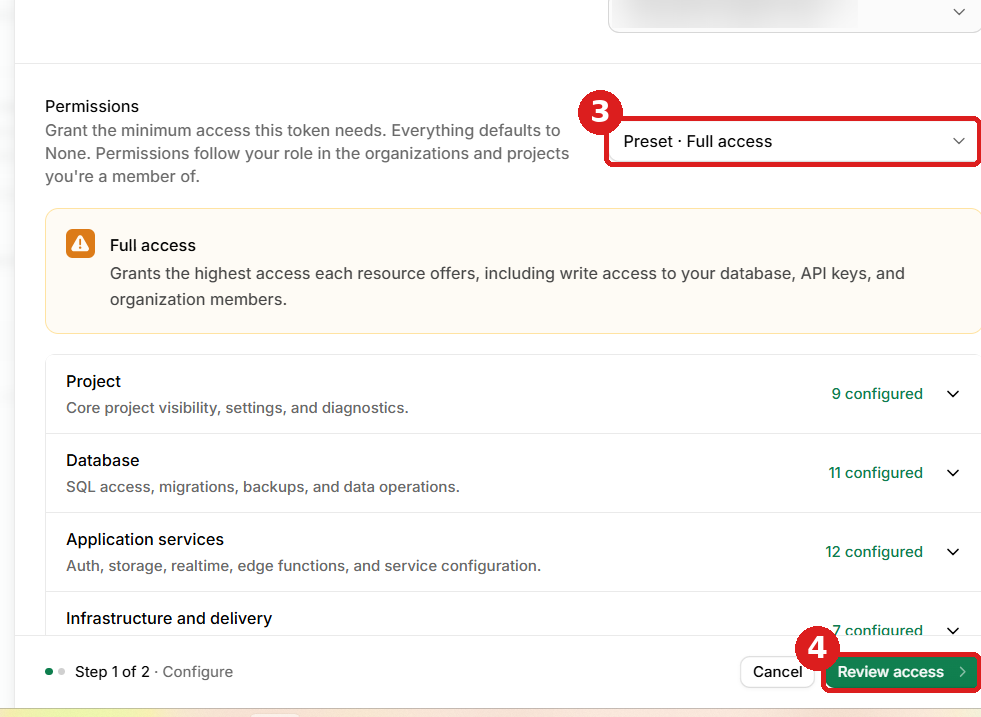

3. Copiar la llave (empieza con `sbp_`). **Se muestra una sola vez.** Dejar esa pestaña abierta y pegarla en el paso 6. **No se anota en ningún lado.**

> 📝 **Anotá en la hoja:** D1 (nombre de la organización de Supabase) y tildá D2 cuando la llave esté cargada en GitHub (paso 6).

> ✅ **Cómo sé que salió bien:** en supabase.com, arriba a la izquierda, se ve la organización con la etiqueta **FREE** (gratis), y en **Access Tokens** aparece «Instalador».

## Paso 5. La cuenta de Cloudflare y su llave

Cloudflare publica la aplicación en internet (una dirección como `inscripciones-laspalmas.pages.dev`).

1. Entrar a **dash.cloudflare.com/sign-up** (crear cuenta) → **Email** (correo): el Gmail de la institución; **Password** (contraseña): una **contraseña nueva** → **Sign up** (registrarse). Puede aparecer el control «¿sos un robot?» (ver el paso 2).
2. Abrir el Gmail: llega un correo de Cloudflare. Tocar el enlace **Verify email** (verificar el correo).
3. Si Cloudflare ofrece agregar un dominio (**Add a domain**), elegir un plan o hacer preguntas: **saltear** (**Skip**) o cerrar. No hace falta nada de eso, y nunca cargar tarjeta.
4. **Verificación en dos pasos:** ícono de la persona (arriba a la derecha) → **My Profile** (mi perfil) → **Authentication** (autenticación) → **Two-Factor Authentication** (verificación en dos pasos) → escanear el código con **Google Authenticator** (como en GitHub) → escribir el número de 6 dígitos → guardar los **backup codes** (códigos de respaldo; imprimirlos o copiarlos a mano).
5. Crear la **llave**. Camino corto: abrir **dash.cloudflare.com/profile/api-tokens**. (Camino largo: **My Profile** → **API Tokens** (llaves).) Tocar **Create Token** (crear llave) → bajar hasta **Create Custom Token** (llave a medida) → **Get started** (empezar).
   - **Token name** (nombre): «Instalador».
   - **Permissions** (permisos), en la primera fila elegir: **Account** → **Cloudflare Pages** → **Edit** (editar). Tocar **+ Add more** (agregar otro) y en la segunda fila: **Account** → **Account Settings** → **Read** (leer).
   - **Account Resources** (cuentas): **Include** (incluir) → la cuenta de la institución.
   - Si aparece **TTL** (fecha de vencimiento), dejarla vacía.
   - Abajo: **Continue to summary** (ver resumen) → **Create Token** (crear llave).
6. Copiar la llave. **Se muestra una sola vez.** Pegarla en el paso 6.

> 📝 **Anotá en la hoja:** E1 (contraseña), E2 (dónde guardaste los backup codes) y E3 (fecha de vencimiento de la llave, si tiene).

> ✅ **Cómo sé que salió bien:** en **My Profile → API Tokens** aparece «Instalador» con estado **Active** (activa).

## Paso 6. Cargar las cuatro claves en GitHub

1. En GitHub, abrir el repositorio **app-inscripciones** de la institución → pestaña **Settings** (configuración; arriba, a la derecha de la fila de pestañas) → en el menú de la izquierda, **Secrets and variables** (secretos y variables) → **Actions**. Camino corto: escribir en el navegador la dirección del repositorio (casilla C5) y agregarle al final **/settings/secrets/actions**.
2. Para cada una de las cuatro claves de la tabla: tocar el botón verde **New repository secret** (nuevo secreto) → en **Name** (nombre) escribir el nombre **exactamente** así, con mayúsculas y guiones bajos → en **Secret** (secreto) pegar el valor → **Add secret** (agregar). **No** usar «Manage environment secrets» (es otra cosa): siempre el botón verde **New repository secret**, de la parte de abajo.

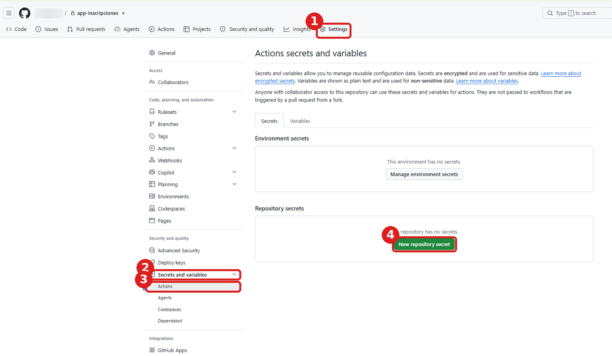

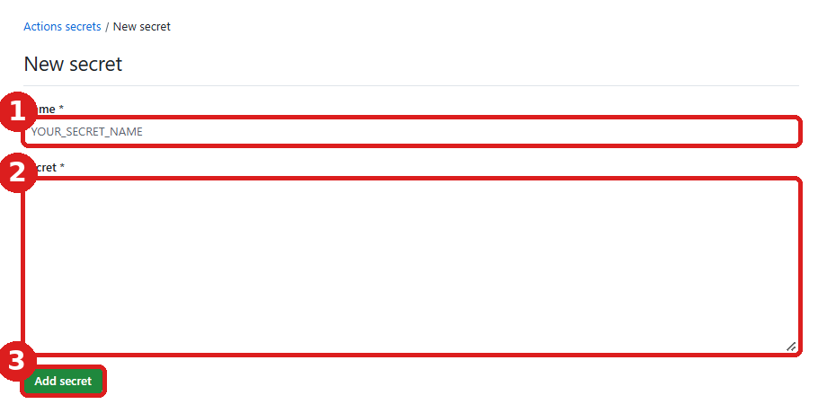

| Nombre | Qué se pega |
|---|---|
| `SUPABASE_ACCESS_TOKEN` | La llave de Supabase (paso 4) |
| `CLOUDFLARE_API_TOKEN` | La llave de Cloudflare (paso 5) |
| `CLAVE_RESPALDO` | Una clave **inventada** y larga (mínimo 16 caracteres; por ejemplo, cuatro palabras con números). **Sin ella no se pueden abrir los respaldos** |
| `GMAIL_CLAVE_APLICACION` | La contraseña de aplicación de 16 letras (paso 1, casilla B6). Da lo mismo con o sin los espacios del medio |

> GitHub guarda los secrets cifrados y no los vuelve a mostrar. Si uno se carga mal, se vuelve a crear con el mismo nombre (reemplaza al anterior).

> 📝 **Anotá en la hoja:** F1 (la CLAVE_RESPALDO, letra por letra: es la más importante). **Anotala antes de pegarla en GitHub**: después GitHub no la deja ver nunca más, así que la hoja es la única copia. No es una cuenta: no tiene dirección web ni usuario. Tildá también D2 y E4.

> ✅ **Cómo sé que salió bien:** en **Secrets and variables → Actions**, debajo de **Repository secrets**, se ven los **cuatro nombres** de la tabla, escritos igual. (El valor no se ve nunca: es normal.)

## Paso 7. El botón «Instalar»

1. En el repositorio → pestaña **Actions** (acciones: las tareas automáticas), o la dirección del repositorio (casilla C5) con **/actions** al final. Si aparece un cartel con el botón **I understand my workflows, go ahead and enable them** (entiendo, activalas), tocarlo. Si no aparece ningún cartel, está bien: seguí.
2. En la lista de la izquierda, tocar **Instalar**. Arriba a la derecha aparece el botón verde **Run workflow** (ejecutar): tocarlo y se abre un cuadrito. (Abajo dice «This workflow has no runs yet»: todavía no se usó, es normal.)

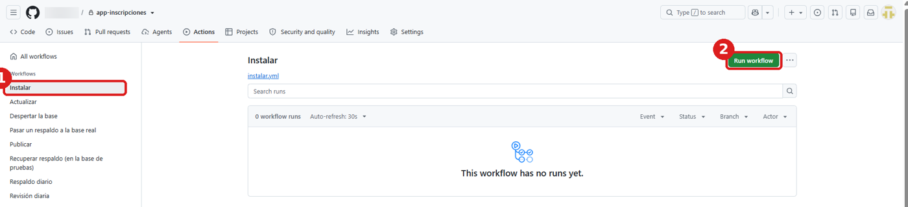

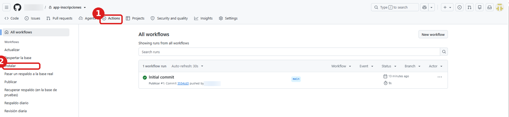

3. Completar:
   - **Nombre de la institución:** como se va a ver en la aplicación (ej.: «Club Atlético Las Palmas»).
   - **Gmail de la institución:** el del paso 1.
   - **Correo del primer Responsable general:** con el que va a entrar al panel esa persona (puede ser el personal).
   - **Nombre y apellido del Responsable general.**
4. Tocar el botón verde **Run workflow** del cuadrito. A los pocos segundos aparece una fila nueva con un círculo amarillo 🟡 (está trabajando; si no aparece, recargar la página con F5). Tarda entre **5 y 15 minutos**: no hace falta quedarse mirando.
5. Cuando termina en verde ✅, tocar la ejecución: arriba aparece el **resumen** con la dirección de la aplicación y la del panel.

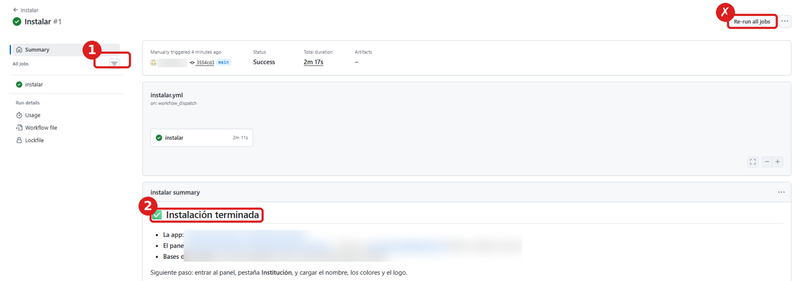

**Qué hace solo el instalador:** crea las dos bases de datos (real y de pruebas), carga todas las tablas y reglas de seguridad, da de alta al Responsable general, configura los correos con el código de ingreso y publica la aplicación. Desde ese momento, todos los días se hace un **respaldo cifrado** y el sistema **se revisa solo** y avisa por correo si algo necesita atención.

**Si termina en rojo ❌:** abrir la ejecución y leer el mensaje en rojo: dice qué falta (por ejemplo, una llave mal copiada). Corregir y volver a tocar **Run workflow**: lo que ya se hizo no se repite.

> 📝 **Anotá en la hoja:** A (datos del Responsable general), G1 (fecha), G2 (dirección de la aplicación) y G3 (dirección del panel, la que termina en `/#panel`).

> ✅ **Cómo sé que salió bien:** la ejecución está en verde ✅ y, al abrir la dirección de la aplicación en el navegador, aparece la pantalla para activar un QR.

## Paso 8. Primer ingreso al panel

1. Abrir la dirección del panel (G3) en la computadora.
2. Escribir el correo del Responsable general → **Enviarme el código** → escribir el código de 6 números que llega por correo (la primera vez, mirar en **Spam** o **Promociones**).
3. Arriba del Resumen aparece la lista **Primeros pasos**. Seguí el documento **3 · Después de instalar**.

> ✅ **Cómo sé que salió bien:** entrás al panel y arriba dice «Hola, *tu nombre* · Responsable general».

---

## Si algo sale mal durante la instalación

| Qué pasa | Qué hacer |
|---|---|
| El instalador dice «Faltan datos: …» | Falta uno de los cuatro secrets o un dato del formulario. Revisar el paso 6 |
| «Cloudflare respondió 403» o «Supabase respondió 401» | La llave está mal copiada o no tiene los permisos de los pasos 4 o 5. Crear una nueva y cargarla otra vez |
| «La base … tardó demasiado en estar lista» | Supabase está lento. Esperar unos minutos y volver a tocar **Run workflow** |
| No llega el código de ingreso | Mirar en Spam. Revisar la contraseña de aplicación del Gmail (paso 1) y volver a instalar |
| «Este correo no está habilitado» | Ese correo no es el que se puso como Responsable general en el paso 7 |
| Google bloqueó el Gmail por intentos | Esperar unas horas y entrar con el correo de recuperación (B4) |

Los problemas del uso diario están en **6 · ¿Qué hago si…?**

---

## Mantenimiento (después de instalar)

- **El sistema se revisa solo** todos los días a la mañana y, si algo necesita atención, manda un correo **en castellano** a los Responsables generales, con qué hacer. En el panel: **Estado del sistema**.
- **Respaldos:** todos los días a la madrugada, cifrados con la CLAVE_RESPALDO (F1). Para recuperar uno: GitHub → **Actions** → **Recuperar respaldo (en la base de pruebas)**; para pasarlo a la base real, **Pasar un respaldo a la base real** (pide escribir REEMPLAZAR LA BASE REAL y se puede deshacer).
- **Actualizaciones:** cuando salga una versión nueva, GitHub → **Actions** → **Actualizar** → **Run workflow**. No se pierden datos. Si el panel dice «La base de datos está desactualizada», es la señal de que hay que tocarlo.
- **Si vence una llave:** crear una nueva (pasos 4 o 5) y cargarla en GitHub con el mismo nombre (paso 6). Anotar el vencimiento nuevo (E3).
- **Si una base se «duerme»:** no hay que hacer nada (se despierta sola dos veces por día). Con apuro: GitHub → **Actions** → **Despertar la base** → **Run workflow**. Ver la tabla de abajo.
- **Si cambia el Responsable general:** el nuevo se da de alta en **Personas y roles** y se le entrega esta carpeta y la Hoja de accesos.

## Si una base se «duerme» (pausa del plan gratuito): qué hacer en cada caso

El plan gratuito de Supabase pausa una base que no se usa durante una semana. **El sistema lo resuelve solo**: dos veces por día (a las 6 y a las 18) revisa las dos bases, despierta la que esté pausada y les hace una consulta mínima para que no se vuelvan a pausar. También evita que GitHub apague las tareas automáticas por falta de cambios.

| Qué pasa | Qué hacer |
|---|---|
| No pasa nada raro | **Nada.** El sistema mantiene las bases despiertas solo |
| Llega un correo: «La base … estaba pausada y se despertó sola» | **Nada.** Ya está resuelto y no se perdió nada |
| El panel no conecta o dice que la base está «dormida» | **Esperar**: se despierta sola en unas horas. Los celulares siguen cargando y envían todo después |
| …y hay apuro (por ejemplo, es el día del evento) | GitHub → **Actions** → **Despertar la base** → **Run workflow** → **Run workflow**. Esperar el verde ✅ (5 a 10 minutos) y actualizar el panel (F5) |
| «Despertar la base» termina en rojo ❌ y habla de la «llave de Supabase» | Crear una llave nueva (paso 4) y cargarla en GitHub con el mismo nombre, `SUPABASE_ACCESS_TOKEN` (paso 6). Volver a tocar **Run workflow** |
| «Despertar la base» termina en rojo ❌ por otro motivo | supabase.com → abrir el proyecto → **Resume project** (el botón blanco; **nunca** «Upgrade to Pro», que es pago) |

