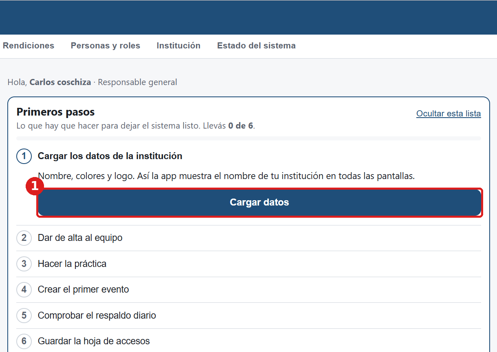
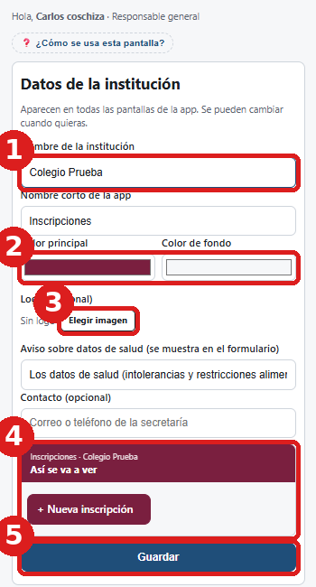
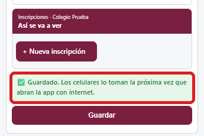
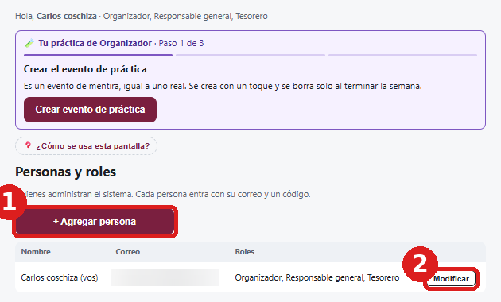
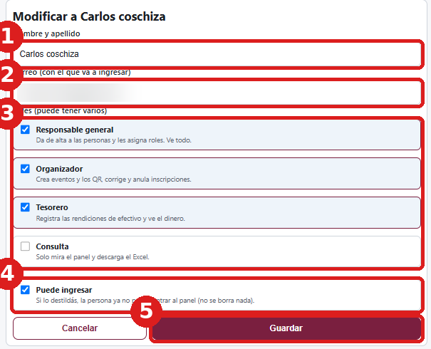
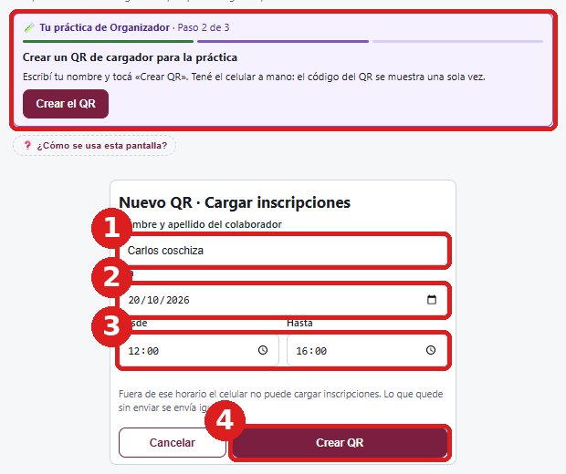
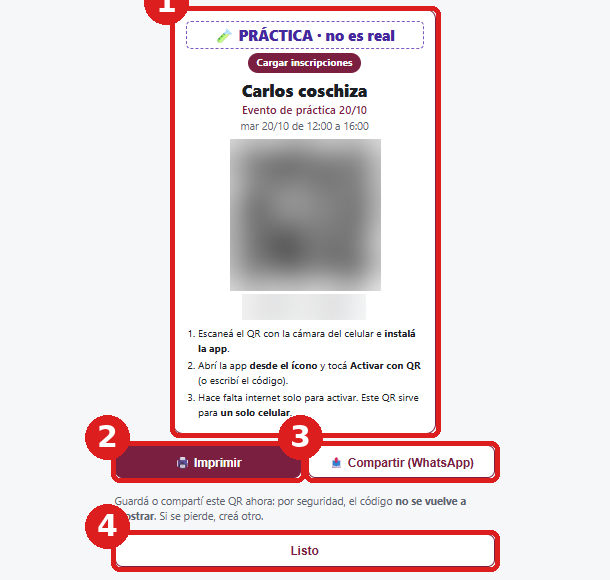
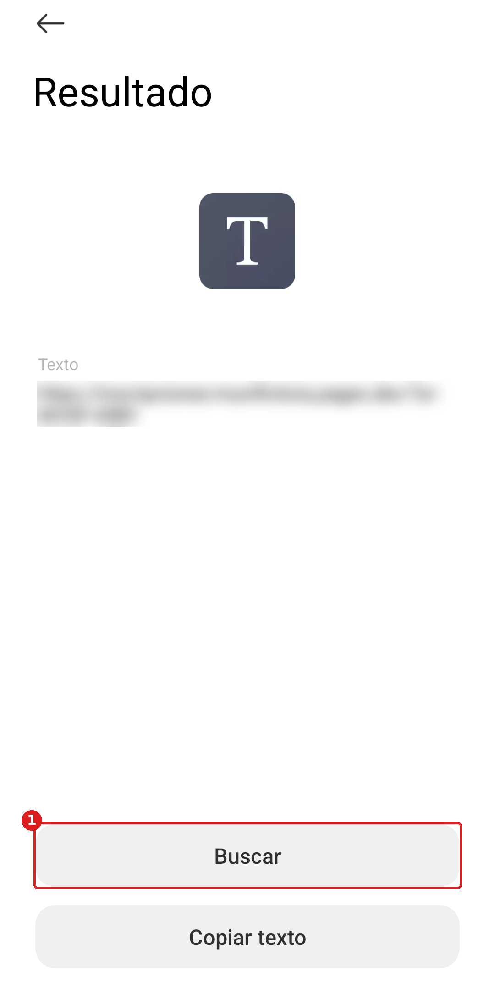
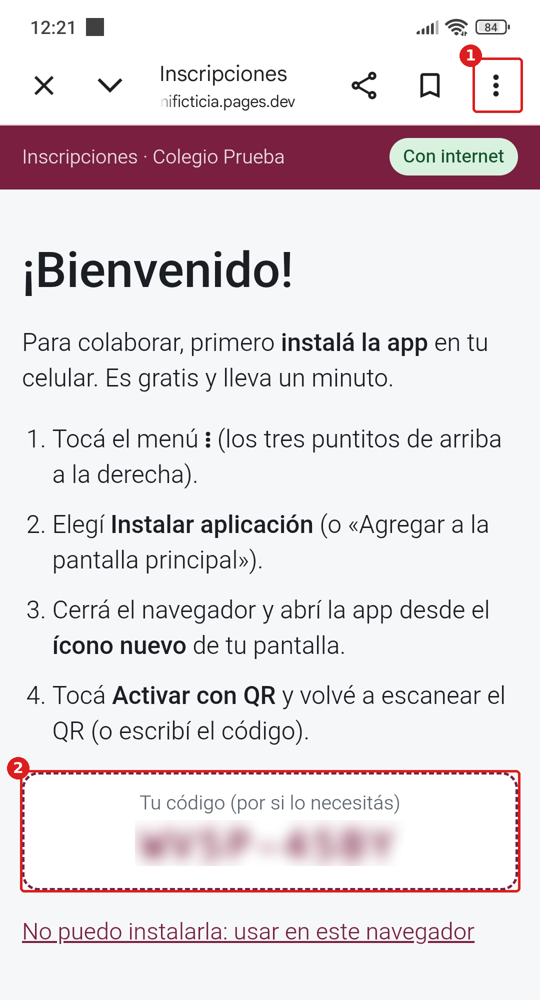

# Después de instalar: dejar todo listo

Ya instalaste el sistema y entraste al panel. Ahora falta prepararlo para usarlo de verdad. Todo se hace **dentro de la aplicación, en castellano**, en unos 20 minutos.

**Dónde:** en la computadora, la dirección del panel (casilla **G3** de la hoja de accesos, la que termina en **/#panel**). Si te pide entrar: tu correo → **Enviarme el código** → el código de 6 números que llega por correo → **Entrar**.

**Cómo:** arriba de la pestaña **Resumen** está la lista **Primeros pasos**. Cada paso tiene un botón que lleva a la pantalla donde se hace, y **se tilda solo** cuando está hecho. Al terminar cada paso, volvé a la pestaña **Resumen** (arriba a la izquierda) para ver el siguiente.

> En cada pantalla hay un botón **«¿Cómo se usa esta pantalla?»** y, en la aplicación, la guía **«¿Qué hago si…?»**. Lo que no se nombra acá se deja como está.

## 1. Los datos de la institución

1. En **Primeros pasos**, tocá **Cargar datos** (o la pestaña **Institución**).
2. Completá: **Nombre de la institución** (como se va a ver en todas las pantallas), los **colores** (tocá el recuadro de color y elegí uno), el **logo** si tenés (**Elegir imagen**) y, si querés, un **contacto**. El **Nombre corto de la app** y el **Aviso sobre datos de salud** ya vienen escritos: se pueden dejar así.
3. Abajo se ve **«Así se va a ver»**: una vista previa con tu nombre y tus colores.
4. Tocá **Guardar**.

> ✅ **Salió bien si** aparece el cartel verde **«Guardado»** y la barra de arriba cambia al nombre y al color de la institución. Después volvé a **Resumen** (o tocá **Listo: volver a Primeros pasos**).

## 2. El equipo

1. En **Primeros pasos**, tocá **Ir a Personas y roles** (o la pestaña **Personas y roles**).
2. **Para darte roles a vos:** en tu fila tocá **Modificar** y tildá los roles que vas a usar. **Para sumar a otra persona:** **+ Agregar persona** → nombre y apellido, el **correo con el que va a entrar** y sus roles.
3. **Puede ingresar** queda tildado. Tocá **Guardar**.

Hace falta al menos un **Organizador** (arma los eventos) y un **Tesorero** (recibe el efectivo). Pueden ser la misma persona, incluso vos: una persona puede tener varios roles.

| Rol | Qué hace |
|---|---|
| Responsable general | Da de alta a las personas y ve todo |
| Organizador | Crea eventos, genera los QR, corrige y anula |
| Tesorero | Registra las rendiciones de efectivo y tickets |
| Consulta | Solo mira el panel y baja el Excel |

Cada persona entra al panel con **su correo**: le llega un código de 6 números. No hay contraseñas.

> ✅ **Salió bien si** aparecen arriba pestañas nuevas según los roles (por ejemplo **Crear eventos** y **QR de colaboradores**) y, arriba, un recuadro violeta **«Tu práctica de Organizador»**.

## 3. La práctica (antes del primer evento real)

Cada Organizador y cada Tesorero **practica primero** con un evento de mentira: lleva unos 10 minutos y evita errores con datos reales. **Un recuadro violeta arriba de la pantalla guía la práctica paso por paso** y avanza solo. La práctica dice 🧪 **PRÁCTICA** en todos lados, no se mezcla con lo real y **se borra sola** al terminar la semana.

**Qué hace falta:** la computadora y **un celular con internet**.

**Paso 1 de 3 · Crear el evento de práctica:** en el recuadro violeta, tocá **Crear evento de práctica**. Se crea con un toque.

**Paso 2 de 3 · Crear un QR de cargador:** en el recuadro violeta, tocá **Crear el QR**. Aparece **«Nuevo QR · Cargar inscripciones»**: tu nombre, el día y el horario ya vienen completos → **Crear QR**.

Aparece el QR (con la etiqueta 🧪 PRÁCTICA). **El código se muestra una sola vez:** dejá esta pantalla abierta hasta activar el celular. Con **Imprimir** o **Compartir (WhatsApp)** se le manda a un voluntario; para la práctica no hace falta.

**Paso 3 de 3 · Cargar una inscripción desde el celular**, en el celular:

1. Abrí la **cámara** y apuntá al QR de la pantalla. Tocá el enlace que aparece. (Si el celular abre un lector de QR que muestra «Resultado» y un botón **Buscar**, tocá **Buscar**.)
2. Se abre **«¡Bienvenido!»**. Tocá los **tres puntitos ⋮** (arriba a la derecha) → **Instalar aplicación** (o «Agregar a la pantalla principal»). Si no aparece, elegí primero **Abrir en Chrome** y volvé a tocar ⋮.
3. Cerrá Chrome y abrí la app desde el **ícono nuevo** de la pantalla del celular.
4. Tocá **Activar con QR** y escaneá otra vez el QR de la computadora (o escribí el código que muestra).
5. Tocá **+ Nueva inscripción** y cargá una persona de mentira → **Guardar**. Probá también una con el celular en **modo avión**: queda guardada y se envía sola cuando vuelve la señal.

Para completar el paso falta **marcar un presente**: al cargar otra inscripción tildá **«Ya está presente»**, o creá un **QR de control de presentes** y tocá **Presente** en alguien. El recuadro violeta dice qué falta.

**Práctica del Tesorero:** **Rendiciones** → elegir la práctica (🧪) → **Registrar entrega** en la fila del cargador.

> ✅ **Salió bien si** el recuadro violeta desaparece y en **Primeros pasos** se tilda **Hacer la práctica**.

## 4. El primer evento real

**Crear eventos** → **Crear evento nuevo**. El asistente hace preguntas simples, de a una: nombre, fechas, cómo se inscriben (persona, pareja o grupo), presencial o virtual, categorías, datos que se piden, qué se cobra y cómo se toma asistencia. Se guarda solo en cada paso.

Antes de abrirlo, **probá el formulario en la vista previa**: después de abrir el evento, el formulario y los precios ya no se pueden cambiar.

Después: **QR de colaboradores** para los cargadores y la puerta. Ver el **Manual del Organizador** (carpeta 4).

> Si creaste un evento por error y todavía no tiene inscripciones, se puede **borrar**: **Resumen** → abajo, **Borrar o archivar este evento…**

## 5. El respaldo diario

No hay que hacer nada: al día siguiente de instalar, el paso **Comprobar el respaldo diario** se tilda solo cuando la revisión diaria ve un respaldo bueno. Si a los dos días no se tildó, mirá la pestaña **Estado del sistema**: dice qué pasa y qué hacer.

## 6. La hoja de accesos

Guardala en un lugar seguro (no en la computadora). En **Primeros pasos**, en ese paso, tocá **Ya lo hice**.

> ✅ Cuando todo está hecho, arriba del Resumen dice **«Primeros pasos completos»**. El sistema está listo para usarse.
